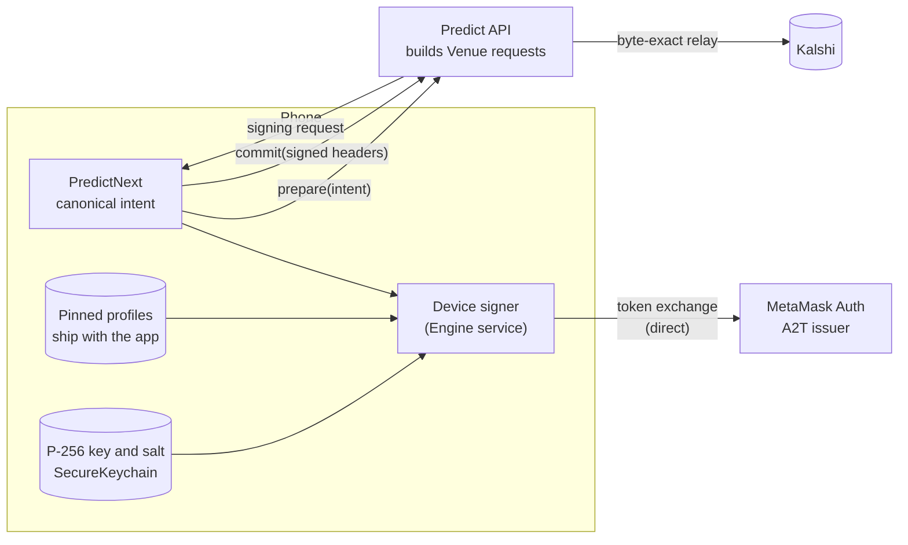
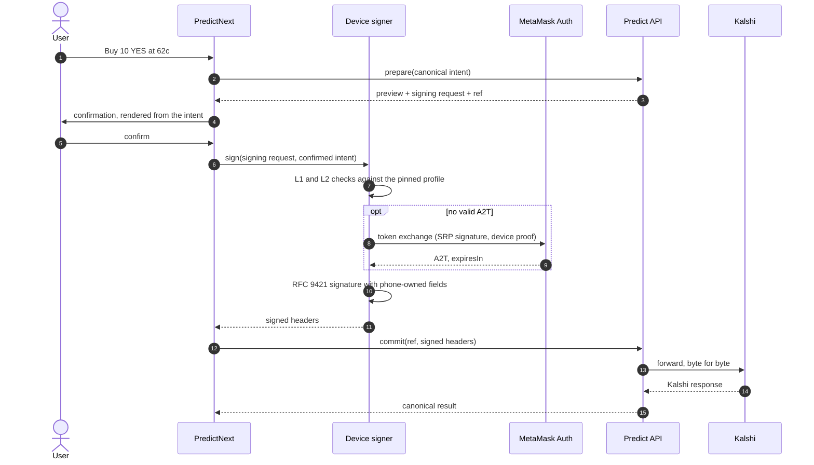

# Backend-built venue requests, signed on the phone under pinned profiles

The Predict API builds every account-scoped Venue request. The phone signs it with a device key, but only after checking it against a signing profile that ships with the app. The phone holds no Venue-specific code. It holds a generic signer and a small block of pinned data per Venue that describes what a legitimate request looks like. The Predict API can never change that data.

Status: proposed, 2026-10-27. Discussion input for [#37727](https://github.com/MetaMask/metamask-mobile/pull/37727) (PRED-1370) and PRED-1362.

Implementation status: the initial Engine capability is implemented for the
bundled Kalshi P-256 profile and opaque A2T issuance. It keeps the current
two-signature exchange (SRP challenge plus device proof), accepts the preferred
`{ a2t, expiresIn }` response and temporary absolute-`exp` response without
decoding token claims, and owns lock/profile/flag/reset invalidation. Generic
request signing and remotely supplied signing profiles remain future work; the
service intentionally exposes no arbitrary-byte signing action. The bundled
profile now selects the allowlisted `device-p256-salt-v1` implementation and
pins its stable key slot, proof prefix, and issuer paths. That implementation
fixes the public-key encoding, signature encoding, 16-byte salt, and SHA-256
commitment.
Storage is derived internally from the key slot, so profiles cannot redirect
keychain access. Remote configuration may select a bundled profile ID but
cannot override those instructions.

## Context

Kalshi's ISV model, recorded in the Kalshi security and identity ADR ([decisions#241](https://github.com/MetaMask/decisions/pull/241)), works like this:

- The phone creates a P-256 key and a 16-byte salt. The private key never leaves the device.
- MetaMask Auth issues an A2T, a short-lived JWT whose `nonce` commits to that key and salt.
- Every user request to Kalshi carries the A2T and an RFC 9421 HTTP message signature made with the device key. A read signature covers method, authority, path, query, the A2T and the device headers. A mutation signature also covers a SHA-256 digest of the exact body.
- The Predict API relays the request byte for byte.

The device key and the signing have to stay on the phone. Kalshi's spec states why: "MetaMask's backend can forward a signed order, but it cannot change the order from buy to sell or change the amount without invalidating the signature."

That guarantee holds only if the phone knows what it signs. PredictNext's goal is to keep Venue logic in the Predict API. If the Predict API builds the request and the phone signs whatever it receives, the signature proves only that the app was open. The two goals conflict, and this ADR settles the conflict.

PR #37727 adds the device key and the A2T session. It puts the Kalshi token exchange, JWT claim checks, the issuer URL and the session lifecycle in `PredictNext/auth/`, mounts them as React components around the navigator, and imports PredictNext internals from `Authentication.ts`. The key handling is right. Most of the rest belongs elsewhere.

## Decision

1. The Predict API builds every Venue request (method, path, query and body bytes) and relays it unchanged after the phone signs it.
2. The phone signs only under a signing profile. A profile has two parts. The first is generic signing code in the app, such as `device-p256-rfc9421-v1` now and `eip712-wallet-v1` when Polymarket moves to the backend. The second is pinned data for each Venue.
3. The pinned data ships with the app. The Predict API never serves it, and no Predict API response can override it.
4. The phone sets the fields that prove identity and freshness. The Predict API sets the fields that describe the operation, and the phone checks them.
5. Every request passes route checks (L1). Every mutation also passes intent binding (L2).
6. The phone gets the A2T from MetaMask Auth directly and treats it as an opaque string with an `expiresIn`.
7. Keys and tokens live in an Engine service with one key per profile. The service follows `KeyringController` lock and unlock, and wallet reset reaches it through the Engine messenger.
8. The confirmation screen renders from the user's intent and the bound fields, never from display strings in the Predict API response.
9. The phone requests an A2T only when a signed request needs one. Browsing needs none.

### Trust boundaries



The Predict API decides what to sign. The pinned profile decides what the phone will agree to sign.

### Placing an order



The phone signs at step 7, after the user confirms, because a signature lives at most 300 seconds and this design uses 60.

### Pinned profile

The routes, field names and pointers below are illustrative. Kalshi supplies the real route table: "Kalshi supplies each route's method, path, signature class, maximum signature lifetime, and body-size limit."

```ts
// Ships in the app bundle. No Predict API response can change it.
export const PINNED_VENUE_PROFILES = {
  kalshi: {
    profile: 'device-p256-rfc9421-v1',
    issuer: { url: MM_AUTH_URL, audience: 'https://demo-api.kalshi.co' },
    authority: 'demo-api.kalshi.co',
    signature: { label: 'kalshi', tag: 'kalshi-device-request-v1' },
    headers: {
      tokenScheme: 'Kalshi-A2T',
      requestId: 'kalshi-device-request-id',
      key: 'kalshi-device-key',
      salt: 'kalshi-device-key-salt',
    },
    maxLifetimeSec: 60,
    routes: {
      'GET /trade-api/v2/portfolio/balance': { class: 'signed_read' },
      'POST /trade-api/v2/portfolio/orders': {
        class: 'mutation',
        bind: {
          marketRef: '/ticker',
          side: '/side',
          action: '/action',
          count: '/count',
        },
      },
      'POST /trade-api/v2/isv/wallet/register': {
        class: 'mutation',
        bind: { payoutAddress: '/address' },
      },
    },
  },
} as const;
```

### Signing

```ts
async function signVenueRequest(
  request: SigningRequest,
  intent: ConfirmedIntent,
) {
  // The profile comes from the app, never from the request.
  const venue = PINNED_VENUE_PROFILES[intent.venueId];

  // L1: the route is allowed, and a read can never turn into a mutation.
  const route = venue.routes[`${request.method} ${request.path}`];
  assert(route, 'route not allowed');
  assert(
    route.class === signatureClassFor(intent.operation),
    'wrong signature class',
  );

  // L2: the body matches what the user confirmed.
  if (route.class === 'mutation') {
    const body = JSON.parse(request.body);
    for (const [field, pointer] of Object.entries(route.bind)) {
      assert(
        jsonPointer(body, pointer) === intent.bound[field],
        `${field} does not match`,
      );
    }
  }

  const a2t = await deviceTokens.get(venue.issuer); // MetaMask Auth, direct
  const created = nowSec();

  return rfc9421.sign(deviceKeys.for(venue.profile), {
    label: venue.signature.label,
    tag: venue.signature.tag,
    created,
    expires: created + venue.maxLifetimeSec,
    method: request.method,
    authority: venue.authority, // pinned, not taken from the request
    path: request.path,
    query: request.query,
    headers: {
      authorization: `${venue.headers.tokenScheme} ${a2t}`,
      [venue.headers.requestId]: uuid(), // also the signature nonce
      [venue.headers.key]: deviceKeys.publicKey(venue.profile),
      [venue.headers.salt]: deviceKeys.salt(venue.profile),
    },
    body:
      route.class === 'mutation'
        ? { bytes: request.body, idempotencyKey: intent.idempotencyKey }
        : undefined,
  });
}
```

### Who sets each field

| Field                            | Set by                    | Check                                        |
| -------------------------------- | ------------------------- | -------------------------------------------- |
| Method, path, query              | Predict API               | Must match a pinned route                    |
| Body bytes                       | Predict API               | Bound fields must equal the confirmed intent |
| `@authority`                     | Pinned profile            | Not accepted from the request                |
| A2T                              | Phone, from MetaMask Auth | Issuer URL and audience are pinned           |
| Device key and salt              | Phone                     | One key per profile                          |
| Request ID, `created`, `expires` | Phone                     | New for every send, valid for 60 s           |
| Idempotency key                  | Phone                     | One per confirmed intent, reused on retry    |

### Assurance levels

| Level | What the phone checks                       | What a compromised Predict API can still do                   |
| ----- | ------------------------------------------- | ------------------------------------------------------------- |
| L0    | Nothing                                     | Change the side, size or wallet of any action the user starts |
| L1    | Route, signature class, lifetime, authority | Change the body of an allowed mutation                        |
| L2    | L1 plus bound body fields                   | Drop, delay, or replay within 60 s. Serve a forged catalog    |

L1 applies to every request and L2 applies to every mutation. L0 is rejected.

## Security

| Threat from a compromised Predict API                                                                                   | Mitigation                                                                        |
| ----------------------------------------------------------------------------------------------------------------------- | --------------------------------------------------------------------------------- |
| It changes an order's side, count or price                                                                              | L2 binding on order routes                                                        |
| It returns an order to sign when the user only opened their portfolio                                                   | L1 signature class check                                                          |
| It swaps the payout wallet at activation, which redirects every later withdrawal                                        | L2 binding of `/isv/wallet/register` to the selected account                      |
| It sends the phone to a fake issuer, collects the SRP signature and replays it at MetaMask Auth with its own device key | The issuer URL is pinned                                                          |
| It relays the token exchange and substitutes its own device key                                                         | The phone calls MetaMask Auth directly                                            |
| It reassigns a Venue to a wallet-key profile so the wallet key signs                                                    | The Venue-to-profile mapping is pinned, and each key signs under one profile only |
| It replays a signed request                                                                                             | A 60 s expiry, and an idempotency key set by the phone                            |
| The confirmation shows one order and the signature covers another                                                       | The confirmation renders from the intent and the bound fields                     |
| It maps a market to the wrong ticker in the catalog                                                                     | Not covered. L2 compares against a catalog the Predict API serves                 |
| It returns its own address from deposit-address creation                                                                | Not covered. Kalshi responses are unsigned. See open questions                    |

## Open questions

1. **Deposit addresses.** The relay can replace the address in Kalshi's response. Kalshi's spec allows device-signed requests to go "directly to Kalshi or through MetaMask's backend". Does this one route call Kalshi directly, or does AppSec accept trusting the Predict API for it?
2. **ES256 or RS256.** Kalshi's spec says "Only ES256 over P-256 is accepted" for the A2T. Slack says RS256 has been live on demo since 2026-10-22. Settle this before MetaMask Auth builds its endpoint.
3. **SRP message binding.** The accepted challenge is MetaMask Auth's SRP login message from `createSrpLoginRawMessage` in profile-sync-controller `flow-srp`: `metamask:<nonce>:<srpIdentifier>` with an optional `:primary` or `:secondary`. A signature over that string is also a valid login signature for an auth-API nonce, so whoever serves the challenge can complete a login as the user. The message still omits the device public key and salt. Ask MetaMask Auth for a dedicated prefix that names both, and that Auth rejects on the login endpoint.
4. **Token renewal.** The A2T lives 300 s, and today every renewal needs a new SRP signature from the snap. Can MetaMask Auth renew with the device proof alone after the first issuance?
5. **Where the pins live.** The app bundle is the strongest option. Remote feature flags are a separate trust domain from the Predict API, so they could carry settings that only make the checks stricter, like a shorter lifetime or a disabled route. The authority, issuer and binding map stay in the bundle.
6. **Reads.** Each signed read costs a round trip to get the request built. The phone could build reads from the pinned route template, or the Predict API could return several signing requests in one response.

## Consequences

- PredictNext has no Kalshi code paths. Adding a Venue means pinned data plus, at most, one new signing profile.
- A new or changed Kalshi route needs an app release, because the route table is pinned. That cost is intentional.
- Polymarket on the backend (PRED-1356) follows the same pattern. An `eip712-wallet-v1` profile pins the EIP-712 domain (chain ID, verifying contract) and the allowed primary types, so the wallet never signs a typed message such as a Permit2 approval that the Predict API slipped in.
- The Predict API stays a trusted relay for availability and for Kalshi's responses. It can no longer act for the user.

## What changes in #37727

Keep:

- P-256 key and salt generation, the SecureKeychain storage, the plaintext wipe on lock and the deletion on wallet reset.
- The native keystore plan in `docs/kalshi-device-key.md`.

Change:

- Move the key and token code out of `PredictNext/auth/` into an Engine service named for the profile, not for Kalshi.
- Treat the A2T as opaque. Remove the JWT decoding and claim checks, and use `expiresIn` from the issuer response.
- Take the issuer URL and audience from the pinned profile. A build-time env value counts as pinned.
- Remove `KalshiDeviceKeyBootstrap` and `KalshiA2tSessionBootstrap`. The Engine service subscribes to `KeyringController` lock and unlock, and requests a token on the first signed request.
- Reach wallet reset through the Engine messenger, and remove the `Authentication.ts` import of `PredictNext/auth/a2tSessionInstance`.

Later PR: the RFC 9421 signer, the L1 and L2 checker, and the `prepare` and `commit` contract with the Predict API.

## Alternatives rejected

- **The phone builds Venue requests.** This is secure, but it puts Kalshi request code on the phone, against the PredictNext architecture.
- **The Predict API serves the profile with the request.** The Predict API would then write both the request and the rules that approve it, so the checks would protect nothing.
- **A Venue-neutral session route on the Predict API that proxies the token exchange.** The SRP signature does not cover the device key, so the proxy could get an A2T for a key it controls. Kalshi's spec names this attack: "The backend must not be able to ask the signing service to authorize an arbitrary key for another user."
- **Signing without checks (L0).** It still stops token minting and actions for users who are not in the app, but it removes Kalshi's guarantee that the order can't be changed in transit.
