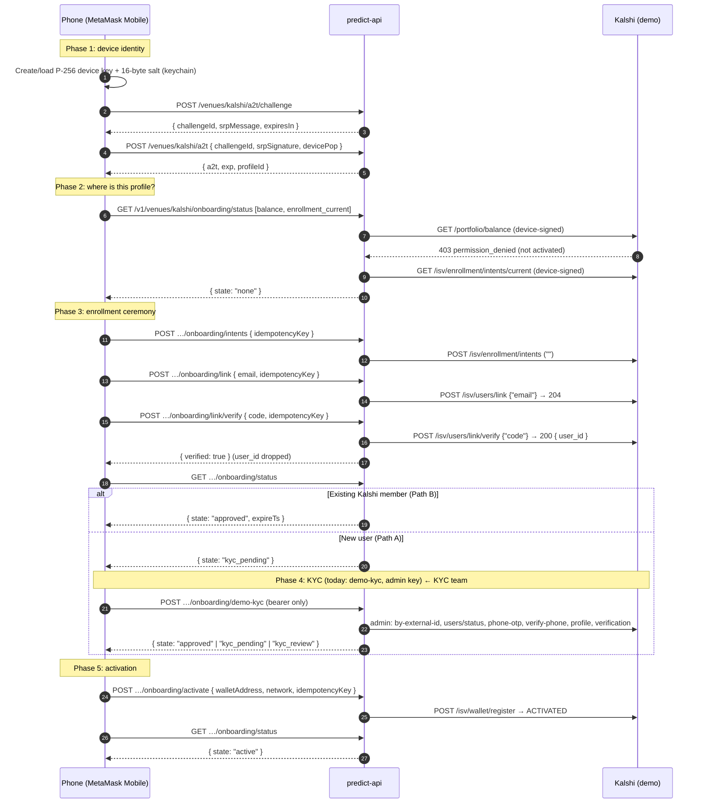
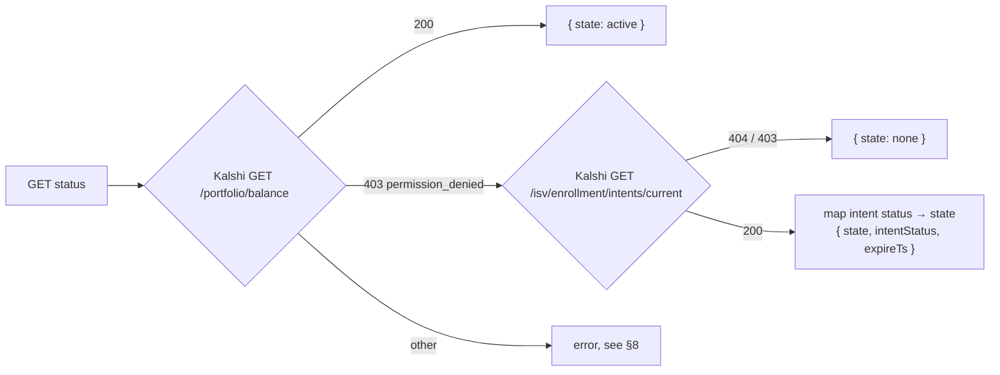
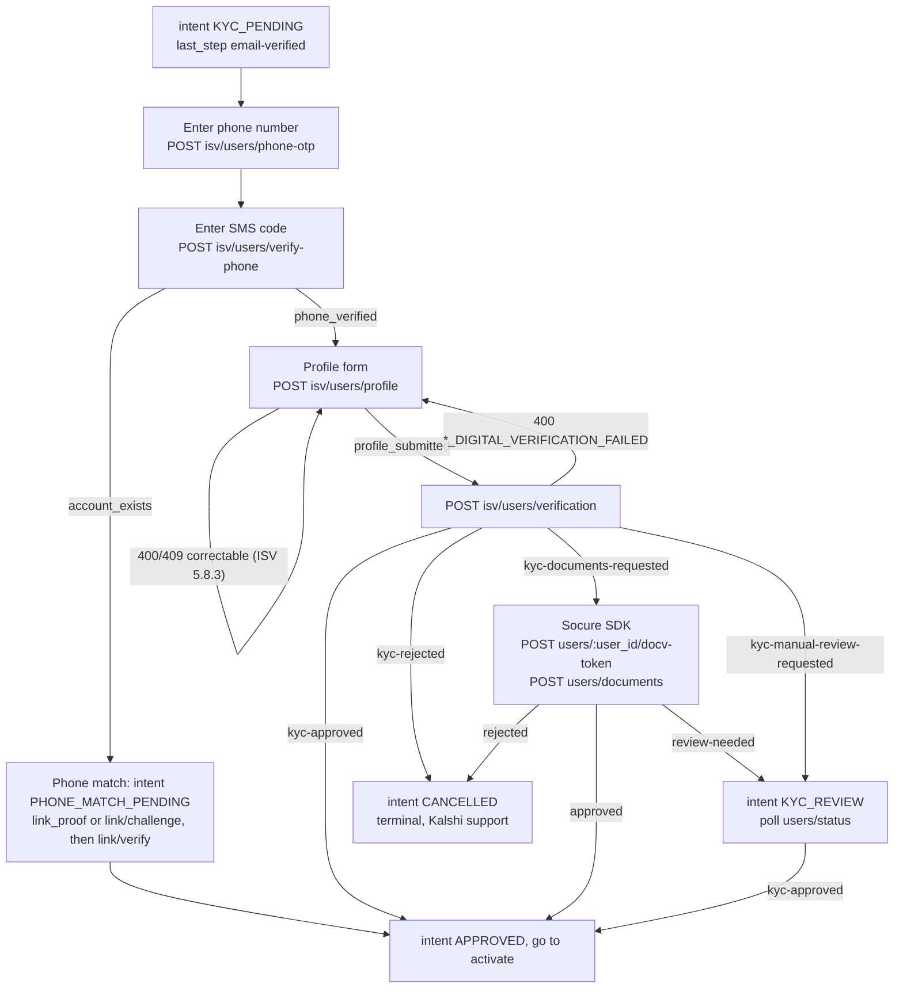
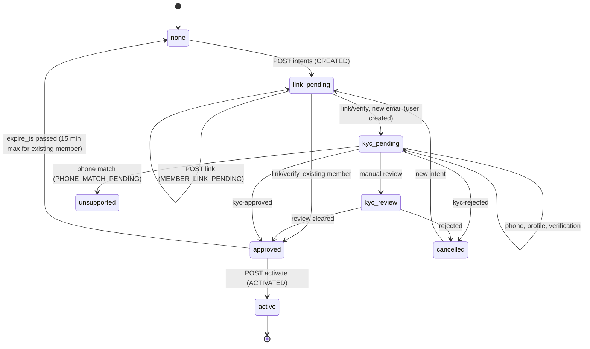

# Kalshi onboarding: call flow from new device to activated account

- **Audience:** KYC team (mobile + predict-api)
- **Date:** 2026-11-04
- **Source of truth:** the code on this branch (mobile `PredictNext/onboarding`, `adapters/remote/KalshiOnboardingClient.ts`, `auth/*`; predict-api `apps/api/src/app/kalshi-onboarding`, `apps/api/src/app/kalshi-a2t`). Gaps filled from the _Kalshi ISV External Specification_ (cited as **ISV §n**).
- **Status:** Demo only. Values marked 🧪 are demo placeholders. The `demo-kyc` step (§5) is the part the KYC team replaces.

## 0. The whole thing on one page



The user never picks "new" or "existing". Kalshi hides whether an email exists (`link` is always 204). The path is only known after `link/verify`, from the intent status: `APPROVED` = existing member, `KYC_PENDING` = new user (ISV §4.2, §5.7).

## 1. Conventions used by every onboarding call

**Base URL:** `MM_PREDICT_API_URL` + `/v1/venues/kalshi/onboarding/…` (A2T routes are unversioned: `/venues/kalshi/a2t…`).

**Headers sent by the phone** (`KalshiOnboardingClient.#send`):

```http
Authorization: Bearer <MetaMask access token>
Accept: application/json
Content-Type: application/json        # POST only
x-metamask-clientproduct: metamask-mobile
x-metamask-clientversion: <app version>
Venue-Authorization: <base64url JSON envelope>   # device-signed routes only
```

**`Venue-Authorization`** (ADR-0004). The phone renders the exact Kalshi request(s) from its bundled signing profile (`KALSHI_DEMO_SIGNING_PROFILE`, `auth/venueSigningProfiles.ts`) plus the user's inputs, signs them (RFC 9421, P-256, 60 s lifetime), and sends the signatures on the first call. predict-api renders the same requests from the same profile, checks the signatures, and relays to Kalshi byte-for-byte.

```json
{
  "v": 2,
  "signingProfileId": "kalshi-demo-signing-v2",
  "step": "default",
  "credential": {
    "a2t": "<jwt>",
    "deviceKey": "<b64url 65B>",
    "salt": "<b64url 16B>"
  },
  "signatures": [
    {
      "requestId": "<uuid>",
      "signatureInput": "kalshi=(…)",
      "signature": "kalshi=:…:"
    }
  ]
}
```

**Idempotency keys** are UUID v4, one per user action (Continue / Verify / Resend / Activate), reused only on retry of the same action. In memory only.

**Errors** always have the shape `{ statusCode, code, message, details? }`. Branch on `code` (full table in §8). `401` always means the MetaMask bearer, never Kalshi.

**PII:** email, code and KYC data are never logged, persisted, or put in Redux. The phone never sees the Kalshi `user_id`.

## 2. Phase 1: device identity (new device)

Runs automatically in `PredictDeviceAuthService` once the user is signed in, the wallet is unlocked and Kalshi is enabled. No UI.

### 2.1 Device key

`auth/p256DeviceKey.ts`. First run on a device creates a P-256 key and a 16-byte salt, stored in the keychain (`com.metamask.predict.device-key.kalshi-v1`, `WHEN_UNLOCKED_THIS_DEVICE_ONLY`). Reinstall = new key + salt. A new device does **not** need to be registered with Kalshi: the A2T binds the key to the MetaMask profile (ISV §3).

### 2.2 Get an A2T (Account-to-Token)

**Step 1 – challenge**

```http
POST /venues/kalshi/a2t/challenge
Authorization: Bearer <MetaMask access token>
```

```json
{
  "srpIdentifier": "<SRP message-signing public key>",
  "devicePublicKey": "<b64url, 65-byte 0x04||X||Y>",
  "salt": "<b64url, 16 bytes>"
}
```

→ `200`

```json
{
  "challengeId": "<uuid>",
  "srpMessage": "metamask:<nonce>:<srpIdentifier>",
  "expiresIn": 120
}
```

**Step 2 – issue**

The phone signs `srpMessage` with the SRP key, and signs the proof-of-possession string `kalshi-a2t-request-v1\n<challengeId>\n<devicePublicKey>\n<salt>` with the device key.

```http
POST /venues/kalshi/a2t
Authorization: Bearer <MetaMask access token>
```

```json
{
  "challengeId": "<uuid>",
  "srpSignature": "<sig>",
  "devicePop": "<b64url 64-byte r||s>"
}
```

→ `200`

```json
{
  "a2t": "<ES256 JWT>",
  "exp": 1777052322,
  "profileId": "<MetaMask profile id>"
}
```

A2T claims: `iss` predict-api, `sub` = MetaMask `profileId` (this is Kalshi's `external_user_id`), `aud` Kalshi demo, `exp` = `iat + 300`, `nonce` = `b64url(SHA-256(publicKey || salt))`. Cached in memory, refreshed 60 s before expiry. `401 unknown or expired challenge` restarts the exchange once.

## 3. Phase 2: status (run on every Predict entry)

`KalshiDemoOnboardingGate` calls this once per mount of the Predict stack. Everything resumes from here; the phone keeps no flow state across launches.

```http
GET /v1/venues/kalshi/onboarding/status
Venue-Authorization: <signs balance + enrollment_current>
```

Server logic (`KalshiOnboardingService.status`):



→ `200`

```json
{
  "state": "kyc_pending",
  "intentStatus": "PARTNER_ENROLLMENT_INTENT_STATUS_KYC_PENDING",
  "expireTs": "2026-11-04T12:00:00Z"
}
```

`intentStatus` is for logs only. The phone branches on `state` (§6).

## 4. Phase 3: enrollment ceremony (all device-signed)

### 4.1 Create intent

```http
POST /v1/venues/kalshi/onboarding/intents
```

```json
{ "idempotencyKey": "6f1c…-4…" }
```

Relays `POST /trade-api/v2/isv/enrollment/intents` with an **empty** body.
→ `200`

```json
{
  "intentStatus": "PARTNER_ENROLLMENT_INTENT_STATUS_CREATED",
  "expireTs": "…",
  "supersededPrevious": false
}
```

A new key supersedes any live intent (`supersededPrevious: true`). Same key on retry recovers the same intent (ISV §5.6).

### 4.2 Send email

```http
POST /v1/venues/kalshi/onboarding/link
```

```json
{ "email": "user@example.com", "idempotencyKey": "<uuid>" }
```

Relays `POST /isv/users/link` `{"email":"user@example.com"}` (trimmed, case kept).
→ `204` always, whether or not the email exists. _Resend_ calls this again with a new key.

### 4.3 Verify code

```http
POST /v1/venues/kalshi/onboarding/link/verify
```

```json
{ "code": "888888", "idempotencyKey": "<uuid>" }
```

🧪 Demo accepts `888888` for the email code (ISV A.4). The field is prefilled but editable. `code` must match `^[0-9]{6,8}$`.

Relays `POST /isv/users/link/verify` `{"code":"…"}`. Kalshi answers `{ user_id }`; predict-api drops it.

→ `200` one of:

```json
{ "verified": true }
```

```json
{ "verified": false, "mfa": { "method": "sms", "phoneLast4": "1234" } }
```

`method` ∈ `sms | email | authenticator-app` (`obfuscatedEmail` for email). On `verified: false` the phone shows the MFA step and posts the second code to the **same** route.

After `verified: true` the phone polls `GET status` (every 2 s, 5 s on slow networks, ≤ 60 s) until it leaves `link_pending`.

## 5. Phase 4: KYC (new users only) ← **KYC team scope**

### 5.1 What runs today (`POST /onboarding/demo-kyc`)

Bearer only, no device signature. Registered only when `KALSHI_DEMO_ONBOARDING_ENABLED=true`, host and audience are demo, and `NODE_ENV !== production` (else `404 onboarding_not_found`). Resolves `user_id` from the JWT `sub`; it **never** accepts a `user_id` from the client.

```http
POST /v1/venues/kalshi/onboarding/demo-kyc
```

→ `200 { "state": "approved" }` (or `kyc_pending` / `kyc_review` if Kalshi lags; the phone then polls `status`).

It is stateless and resumable. Each call re-reads Kalshi and skips finished steps (`KalshiDemoKycService.runDemoKyc`):

| #   | Kalshi admin call (ISV)                                         | Request body                                   | Expected response                                               | Skip / stop rule                                                                                                                                                                        |
| --- | --------------------------------------------------------------- | ---------------------------------------------- | --------------------------------------------------------------- | --------------------------------------------------------------------------------------------------------------------------------------------------------------------------------------- |
| 1   | `GET /isv/enrollment/intents/by-external-id/{profileId}` (§5.6) | —                                              | `{ status, user_id, expire_ts }`                                | `APPROVED` → return `approved`. `ACTIVATED` → `active`. Not `KYC_PENDING` or no `user_id` → `409 onboarding_not_ready`                                                                  |
| 2   | `GET /isv/users/status/{user_id}` (§5.5)                        | —                                              | `{ last_step, digital_verification_status, … }`                 | `kyc-approved` → step 7. `kyc-rejected` → `onboarding_kyc_rejected`. documents / manual review → `onboarding_kyc_not_approved`. `phone-verified` → step 5. `profile-submitted` → step 6 |
| 3   | `POST /isv/users/phone-otp` (§5.2)                              | `{ user_id, phone_number: "+18888888888" }` 🧪 | `{ status: "phone_verification_pending" }`                      | `409 phone_change_mfa_gate_required` → phone already on file, skip to 5                                                                                                                 |
| 4   | `POST /isv/users/verify-phone` (§5.3)                           | `{ user_id, code: "888888" }` 🧪               | `{ status: "phone_verified" }`                                  | `account_exists` → **stop**, `onboarding_phone_matched_existing`                                                                                                                        |
| 5   | `POST /isv/users/profile` (§5.1)                                | see below 🧪                                   | `{ status: "profile_submitted" }`                               | 400/409 → `onboarding_profile_rejected` (`details.code` = Kalshi code)                                                                                                                  |
| 6   | `POST /isv/users/verification` (§5.4)                           | `{ user_id }`                                  | `{ status: "kyc-approved", participant_id, subaccount_number }` | `kyc-rejected` → `onboarding_kyc_rejected`. documents / manual review → `onboarding_kyc_not_approved`                                                                                   |
| 7   | Re-read step 1                                                  | —                                              | intent `APPROVED`                                               | Map to `state` and return                                                                                                                                                               |

🧪 Profile body (ISV A.5/A.6 approval recipe):

```json
{
  "user_id": "<kalshi uuid>",
  "first_name": "test trigger",
  "last_name": "approved",
  "date_of_birth": "1990-01-01",
  "ssn": "777777777",
  "address": {
    "line1": "123 Test St",
    "city": "New York",
    "state": "NY",
    "postal_code": "10001",
    "country": "US"
  }
}
```

Admin calls are signed with the ISV admin key (RSA-PSS, `KALSHI-ACCESS-*` headers, ISV A.3), never by the device.

### 5.2 What the KYC team needs to build

Replace `demo-kyc` with user-driven steps. Keep everything else (status, intents, link, verify, activate, error codes). Suggested shape (server plan §12): one predict-api route per admin call, each bearer-authenticated, resolving `user_id` server-side from `sub`.



Points that the demo path skips and the real flow must handle:

1. **Real phone OTP.** Resend = call `phone-otp` again. Wrong code = `401 invalid_or_expired_code`. Changing an on-file phone needs `POST /isv/users/phone/change/challenge` and a `gate_code` (ISV §5.2.1).
2. **Phone match.** `verify-phone` → `account_exists` moves the intent to `PHONE_MATCH_PENDING`. Keep the same intent. Submit `link_proof` (if returned) to the device-signed `link/verify` as `{"link_proof":"…"}`, otherwise call the device-signed `POST /isv/users/link/challenge` and submit the account MFA code (ISV §5.6.1). Today the status route maps `PHONE_MATCH_PENDING` to `unsupported`, and `link/challenge` / `link_proof` are **not** in the signing profile. Both need adding.
3. **Correctable profile errors.** `SSN_REJECTED`, `INVALID_NAME`, `INVALID_DOB`, `po_box_addresses_are_not_supported`, `*_DIGITAL_VERIFICATION_FAILED`, `address_could_not_be_verified` → re-submit profile, then verification. Errors come one at a time (ISV §5.8.2–5.8.3). Partial profile writes are not rolled back.
4. **Documents.** `kyc-documents-requested` with `next_step.action` / `allowed_actions`. Use `socure_sdk`: mint `POST /isv/users/{user_id}/docv-token`, run the SDK, then `POST /isv/users/documents { user_id, docv_transaction_token }`. `pending` → retry with the same token (ISV §5.8.4).
5. **Manual review.** Intent `KYC_REVIEW`. Poll; never activate in this state. The phone currently gives up after 2 min (`KYC_REVIEW_POLL_LIMIT_MS`).
6. **Timeouts.** Treat a `verification` timeout as unknown. Read `users/status` (`digital_verification_status`: `pending | running | finished`) before resubmitting (ISV §5.8.6).
7. **Terminal.** `kyc-rejected` (incl. `rejection_reason: existing_account`) cancels the intent. Send the user to Kalshi support, no retry.

## 6. Status lifecycle

Three layers of state exist. The phone only sees **predict-api `state`**.

| Kalshi intent `status` (`PARTNER_ENROLLMENT_INTENT_STATUS_*`) | predict-api `state` | Kalshi `last_step` (new user)                             | Phone step                            |
| ------------------------------------------------------------- | ------------------- | --------------------------------------------------------- | ------------------------------------- |
| _(no intent)_                                                 | `none`              | —                                                         | Email                                 |
| `CREATED`                                                     | `link_pending`      | —                                                         | Email                                 |
| `MEMBER_LINK_PENDING`                                         | `link_pending`      | —                                                         | Email (or polling right after verify) |
| `KYC_PENDING`                                                 | `kyc_pending`       | `email-verified` → `phone-verified` → `profile-submitted` | Working (KYC)                         |
| `PHONE_MATCH_PENDING`                                         | `unsupported` ⚠️    | —                                                         | Error (to build, §5.2 item 2)         |
| `KYC_REVIEW`                                                  | `kyc_review`        | `kyc-manual-review-requested`                             | Working, poll ≤ 2 min                 |
| `APPROVED`                                                    | `approved`          | `kyc-approved`                                            | Wallet → Activate                     |
| `ACTIVATED` (balance 200)                                     | `active`            | `kyc-approved`                                            | Done                                  |
| `ACTIVATED` (balance still 403)                               | `inconsistent`      | —                                                         | Error (likely relinked elsewhere)     |
| `CANCELLED`                                                   | `cancelled`         | `kyc-rejected`                                            | Email (new intent)                    |
| anything else                                                 | `unsupported`       | —                                                         | Error                                 |

`last_step` can also be `kyc-documents-requested` (intent stays `KYC_PENDING`) or `account-created` (email not yet proven).

New-account path through the states:



## 7. Phase 5: activation (device-signed)

The wallet step shows the address and network; _Activate_ is the only tap that signs `wallet_register` (the only lasting commitment: it binds the withdrawal destination).

```http
POST /v1/venues/kalshi/onboarding/activate
```

```json
{
  "walletAddress": "0xcDe7CE585799F1FCA8a37C7599935ea275819B9c",
  "network": "base",
  "idempotencyKey": "<uuid>"
}
```

🧪 The phone always signs the Stripe-sandbox address in `demoOnboardingConfig.ts` (`0xcDe7CE585799F1FCA8a37C7599935ea275819B9c` on `base`), because Kalshi demo rejects real ones (`STRIPE_PAYOUT_METHOD_INVALID`). EIP-55 checksummed.

Relays `POST /isv/wallet/register` `{"wallet_address":"…","network":"base"}` (ISV §6.7).
→ `200`

```json
{
  "intentStatus": "PARTNER_ENROLLMENT_INTENT_STATUS_ACTIVATED",
  "payoutMethodId": "…"
}
```

Then the phone reads `GET status` → `{ "state": "active" }`, closes the modal and invalidates the Kalshi balance/positions/activity queries.

An existing member must activate within 15 minutes of `link/verify` and before `expireTs`. Activation re-checks KYC; a `503` here is transient.

## 8. Error codes

| `code`                                        | HTTP    | From                                                               | Phone action                      |
| --------------------------------------------- | ------- | ------------------------------------------------------------------ | --------------------------------- |
| `onboarding_code_incorrect`                   | 400     | verify (`INCORRECT_MFA_CODE`)                                      | Stay on code step, offer Resend   |
| `onboarding_intent_missing`                   | 409     | link (`permission_denied`)                                         | Back to email, new intent         |
| `onboarding_conflict`                         | 409     | verify / activate (`try_logging_in,_user_already_exists`, any 409) | Back to email                     |
| `onboarding_not_approved`                     | 409     | activate (`permission_denied`)                                     | Back to email                     |
| `onboarding_signup_incomplete`                | 409     | verify                                                             | Close: finish signup on Kalshi    |
| `onboarding_user_blocked` / `_deactivated`    | 409     | verify                                                             | Close                             |
| `onboarding_phone_matched_existing`           | 409     | demo-kyc (`account_exists`)                                        | Back to email                     |
| `onboarding_kyc_rejected`                     | 409     | demo-kyc                                                           | Back to email                     |
| `onboarding_kyc_not_approved`                 | 409     | demo-kyc (documents / review)                                      | Back to email                     |
| `onboarding_profile_rejected`                 | 409     | demo-kyc (profile 400/409)                                         | Back to email                     |
| `onboarding_not_ready`                        | 409     | demo-kyc before `KYC_PENDING`                                      | Re-read status                    |
| `onboarding_not_found`                        | 404     | demo-kyc disabled                                                  | Close                             |
| `onboarding_wallet_invalid`                   | 400     | activate (`payout_method_invalid`)                                 | Close, log                        |
| `onboarding_bad_request`                      | 400     | activate (`missing_parameters`)                                    | Close, log (our bug)              |
| `onboarding_rate_limited`                     | 429     | intents / link                                                     | Wait `Retry-After` (default 30 s) |
| `onboarding_unavailable`                      | 503     | any (Kalshi 5xx / unreachable)                                     | Try again, same idempotency key   |
| `onboarding_venue_error`                      | 502     | any other Kalshi 4xx (`details.code`)                              | Try again                         |
| `venue_authorization_invalid`                 | 403     | signature / A2T rejected                                           | Drop A2T, re-sign, retry once     |
| `venue_authorization_required` / `_malformed` | 400/428 | envelope missing / bad                                             | Close, log (our bug)              |

For KYC routes the team adds, keep the same pattern: map each Kalshi code to an `onboarding_*` code in `kalshi-onboarding.map.ts` and a phone action in `kalshiDemoOnboardingMachine.ts`. Correctable profile errors should map to a "stay on form" action, not "back to email" as today.

## 9. Open items relevant to KYC

1. `PHONE_MATCH_PENDING`, `link/challenge` and `link_proof` are not supported yet (status → `unsupported`; not in the signing profile).
2. Demo collisions: every demo new user shares `+18888888888` and the same identity. A second profile may get `account_exists` or `kyc-rejected / existing_account` (server plan §13 Q1).
3. Real withdrawal wallet choice needs design; demo uses a fixed sandbox address.
4. Device key is a software key today; production needs Secure Enclave / Android Keystore (`docs/kalshi-device-key.md`).
5. Where onboarding sits in the product (blocking on entry vs. first trade) is undecided.

## References

- Mobile: `docs/kalshi-device-key.md`, `docs/adr/0003-*.md`, `docs/adr/0004-venue-request-templates.md`
- predict-api: `docs/KALSHI_DEMO_ONBOARDING_PLAN.md`, `apps/api/src/app/kalshi-onboarding/*`, `apps/api/src/app/kalshi-a2t/*`
- Kalshi ISV spec: §3 (auth), §4.2 (paths), §5.1–5.8 (KYC endpoints and recovery), §5.6–5.7 (ceremony), §6.7 (activation), A.4–A.6 (demo values)
