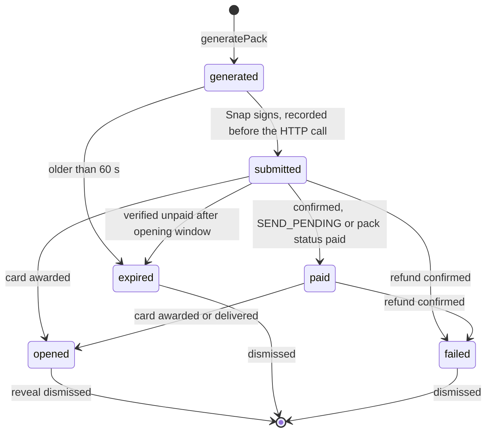

# PackPartner business rules

|                 |                                                                                                                                                                                                                                                                                                                                   |
| --------------- | --------------------------------------------------------------------------------------------------------------------------------------------------------------------------------------------------------------------------------------------------------------------------------------------------------------------------------- |
| **Status**      | Built, documented after the fact · 2026-11-05. Updated 2026-11-11: owned cards and offers are `PackPartnerDataService` reads, operation references use standard controller persistence, and no signed transaction is stored. Describes the complete implementation on `0xEdouardEth/collectibles-rest`, including its parent PRs. |
| **Layer**       | Core. See [Collectibles data sources](./data-sources.md).                                                                                                                                                                                                                                                                         |
| **Scope**       | The rules applied to packs, purchases, openings, recovery, owned cards, buybacks and funding by `PackPartnerProvider` (workflow) and `PackPartnerDataService` (reads), as implemented and tested in `app/components/UI/Collectibles/`.                                                                                            |
| **Not covered** | UI layout, animation and artwork (see the module [README](../../app/components/UI/Collectibles/README.md)); Collectibles API and Social data (see ADRs 0069 and 0070); the Solana Snap's transaction validation (Snap repository).                                                                                                |
| **Design**      | ADR 0068, §6.5 and §7.4 to §7.8                                                                                                                                                                                                                                                                                                   |

This spec states what the code does today. Each rule has a stable identifier and the tests that prove it. When behavior changes, update the rule and its tests in the same PR.

**Identifiers are append-only.** Code and reviews may cite them (for example `PP-PAY-03`). Never renumber or reuse one; add a new identifier at the end of its section, and mark a removed rule as _Withdrawn_ instead of deleting it.

## 1. Principles

These apply to every rule below.

- **Elapsed time alone never proves non-payment.** Once a payment may have been broadcast, the operation is kept until PackPartner's pack status confirms delivery, a refund, or no payment after the 2-hour opening window. A local timeout, an expired blockhash or a missing webhook is not proof that nothing was paid.
- **Never pay twice.** Once a payment may have been sent, nothing is signed or submitted again: resuming an operation only observes it by memo. A retry never generates a replacement purchase on its own.
- **Nothing signed is stored.** Signed transactions exist only for the duration of the submission call. The journal keeps safe references: memos, statuses, amounts and receipts.
- **Server reads are not state.** Owned cards, offers and public pools are `PackPartnerDataService` reads. PackPartner's cards API is authoritative for ownership and is never merged with local data. The controller keeps only the operation journal.
- **Never sell below the confirmed amount.** A buyback is signed only if PackPartner's current refund is at least the amount the user confirmed.
- **State is per account.** Operations and owned-card reads are keyed by Solana address. An action on one account never reads, completes, dismisses or sells anything of another.
- **Animations never drive business work.** Reveal progress is display state. It never starts, gates or cancels a payment, an opening or a sale.
- **Public data is never holdings.** Pack inventory and public openings never become owned cards and never expose a sell action.

## 2. Pack catalogue

| ID        | Rule                                                                                                                                                                                                                        | Verified by                                                                                                                                                                                                                                                                                                                 |
| --------- | --------------------------------------------------------------------------------------------------------------------------------------------------------------------------------------------------------------------------- | --------------------------------------------------------------------------------------------------------------------------------------------------------------------------------------------------------------------------------------------------------------------------------------------------------------------------- |
| PP-CAT-01 | A pack is listed only if its machine is public or explicitly approved for this network, the global machine status is `running`, and `/status` lists its code as `open`. Private approval never overrides live availability. | `packs.test` "excludes private machines", "includes only explicitly approved private machines when open", "excludes machines whose collectibles is closed or missing from status", "returns no pack when machines are stopped"; `PackPartnerDataService.test` "returns only public machines that are open, mapped to packs" |
| PP-CAT-02 | Packs sort by category, then menu order, then price. A missing category or menu order sorts last.                                                                                                                           | `packs.test` "sorts by category, then menu order, then price, nulls last", "defaults missing category and menu order to null"                                                                                                                                                                                               |
| PP-CAT-03 | A pack's maximum value is the highest end of its rarity value bands. Its expected value is shown only when PackPartner publishes one, and is never presented as a guaranteed return.                                        | `packs.test` "maps a public open machine to a pack", "keeps the published expected value when supplied"                                                                                                                                                                                                                     |
| PP-CAT-04 | Malformed machines are dropped; the valid ones are still listed.                                                                                                                                                            | `PackPartnerApiClient.test` "returns the valid machines and drops malformed ones"                                                                                                                                                                                                                                           |
| PP-CAT-05 | Artwork and display names come from the explicit `constants/packArtwork.ts` map; an unknown pack keeps its API name and the default artwork. Artwork never changes price, odds, availability or the purchase payload.       | `PackPurchaseSheet.test` "keeps an unknown pack API name with the default artwork"; `packArtwork.test` "leaves the API title unchanged for unmapped identity %s"                                                                                                                                                            |

## 3. Purchase lifecycle

One purchased pack is one operation, keyed by its PackPartner memo:

`generated`, `submitted` and `paid` are resumable. `opened`, `expired` and `failed` are terminal.

### 3.1 Preparation

| ID        | Rule                                                                                                                                                                                                                                                | Verified by                                                                                                                                                                                                                                                                                                                                                                                         |
| --------- | --------------------------------------------------------------------------------------------------------------------------------------------------------------------------------------------------------------------------------------------------- | --------------------------------------------------------------------------------------------------------------------------------------------------------------------------------------------------------------------------------------------------------------------------------------------------------------------------------------------------------------------------------------------------- |
| PP-GEN-01 | A purchase has 1 to 5 packs (`MAX_MULTIPACK_COUNT`), a positive finite price and, when options are given, an explicit Turbo boolean. Anything else is rejected before calling PackPartner.                                                          | integration "rejects quantity %s before HTTP or signing"; provider "rejects a quantity of %s without calling PackPartner"; `PackPartnerApiClient.test` "rejects count %s before making a request"                                                                                                                                                                                                   |
| PP-GEN-02 | One pack uses `/generatePack`; several use `/generateYoloPacks`. Turbo is independent of quantity, and a single Turbo pack does not request a batch.                                                                                                | provider "stores a generated operation and returns its memo", "stores every pack of a reviewed batch under its batch id"; integration "supports Turbo for one pack without requesting a batch", "prepares a Turbo multipack, signs each reviewed price, and retains both results across restart"; `PackPartnerApiClient.test` "retains the provider batch identifier and the per-pack transactions" |
| PP-GEN-03 | The response must contain exactly the requested number of transactions, each with a distinct, non-empty memo and transaction, none already known for the account. Otherwise nothing is stored.                                                      | `PackPartnerApiClient.test` "rejects incomplete or ambiguous batches"; provider "stores nothing when PackPartner refuses"                                                                                                                                                                                                                                                                           |
| PP-GEN-04 | Each pack is stored as a `generated` operation with its unsigned transaction, pack code, name and price. A batch also stores its ordered memos and its batch id (the `yoloId`, or the memo of a single reviewed pack).                              | provider "stores a generated operation and returns its memo", "stores every pack of a reviewed batch under its batch id"; integration "prepares a Turbo multipack, signs each reviewed price, and retains both results across restart"                                                                                                                                                              |
| PP-GEN-05 | A machine error (HTTP 500 on generation) is `MACHINE_UNAVAILABLE`; HTTP 429 or 503 is `RATE_LIMITED`.                                                                                                                                               | `PackPartnerApiClient.test` "maps a 500 to MACHINE_UNAVAILABLE with the details", "maps a 429 to RATE_LIMITED", "maps HTTP %s to %s (retryable %s)"                                                                                                                                                                                                                                                 |
| PP-GEN-06 | If the wallet is reset while generation is in flight, the result is discarded.                                                                                                                                                                      | integration "discards a generated pack when the wallet resets during its HTTP request"                                                                                                                                                                                                                                                                                                              |
| PP-GEN-07 | A pack price is carried in USDC base units (`priceAmount`, a decimal string) from the catalogue to the signature; the whole-USDC `price` is for display only. A purchase without a positive base-unit price is rejected before calling PackPartner. | provider "rejects %s priceAmount without calling PackPartner"; integration "signs the catalogue price of a pack as its USDC base units"                                                                                                                                                                                                                                                             |

### 3.2 Signing and payment

| ID        | Rule                                                                                                                                                                                                                                   | Verified by                                                                                                                                                                                                                                                                                                                                       |
| --------- | -------------------------------------------------------------------------------------------------------------------------------------------------------------------------------------------------------------------------------------- | ------------------------------------------------------------------------------------------------------------------------------------------------------------------------------------------------------------------------------------------------------------------------------------------------------------------------------------------------- |
| PP-PAY-01 | An unsigned transaction older than 60 seconds (`GENERATED_TTL`) is never signed; the operation becomes `expired`. This is a local freshness limit, not proof of chain expiry.                                                          | provider "expires a generated pack past its TTL without signing it"                                                                                                                                                                                                                                                                               |
| PP-PAY-02 | The Solana Snap signs through `signPackPartnerBuy` with the exact price in USDC base units. The purchase sheet is the user confirmation; the Snap validates and signs without broadcasting.                                            | `solanaSnap.test` "sends the confirmed intent to the Solana Snap client handler"; provider "signs silently, records the purchase submitted, pays and opens after the webhook"; integration "buys a public pack and reveals the card through the API and Snap adapters without storing signed bytes"                                               |
| PP-PAY-03 | A Snap without the guarded method gives `SNAP_UNSUPPORTED`; an unsupported NFT/network or any other guard/signing failure gives `SIGNING_REJECTED`. A failed signature leaves the operation `generated`, so it can be signed on retry. | provider "reports a snap without the guarded buy method", "keeps the pack generated when signing fails, then signs it on retry"; `solanaSnap.test` "maps a Snap without the method to SNAP_UNSUPPORTED", "maps other validation or signing failures to SIGNING_REJECTED", "keeps unsupported NFT guards distinct from a missing Snap method (%#)" |
| PP-PAY-04 | Once signed, the purchase is recorded submitted in controller state before the HTTP call, without transaction bytes. Standard Engine persistence saves the filtered state asynchronously; submission does not wait for a disk write.   | provider "never writes the signed purchase to state"; controller "persists the operation journal using its pruning rules"; integration "resumes a submitted purchase from its persisted projection by memo through its pack status, without paying twice"                                                                                         |
| PP-PAY-05 | The `submitted` record precedes the submit request. A lost response does not prove the payment was never broadcast.                                                                                                                    | provider "records the purchase submitted, without any transaction, before calling submitTransaction", "keeps the purchase submitted when the pack status is unavailable too"; integration "records an attempted payment before HTTP and keeps it recoverable within the opening window"                                                           |
| PP-PAY-06 | A `confirmed` or `finalized` submission makes the pack `paid`. A `submitted` (or unknown) confirmation status keeps it `submitted`.                                                                                                    | provider "signs silently, records the purchase submitted, pays and opens after the webhook", "keeps the purchase submitted when PackPartner only submitted the payment"; integration "keeps a %s payment paid after the opening window until its pack status reports delivery"; `PackPartnerApiClient.test` "maps confirmation status %s to %s"   |
| PP-PAY-07 | After any submission error, including HTTP 4xx, check pack status: confirmed payment advances to paid; otherwise keep submitted for reconciliation. An HTTP refusal alone never authorizes a replacement payment.                      | provider "keeps a submission ambiguous after HTTP $status until status reconciliation", "opens a refused submission whose payment landed anyway", "reports a refused submission once while retaining the operation"; integration "retains an uncertain purchase even after an HTTP refusal"                                                       |
| PP-PAY-08 | Retrying a `submitted` pack never signs or submits again: it is opened and, if needed, resolved by its pack status.                                                                                                                    | provider "opens a submitted purchase on retry without signing or submitting again"; integration "resumes a submitted purchase from its persisted projection by memo through its pack status, without paying twice"                                                                                                                                |

### 3.3 Opening

| ID         | Rule                                                                                                                                                                                                                                                                                                                                                                                                                                                                                                                                        | Verified by                                                                                                                                                                                                                                                                                                                                                                                                                                                                                                                                                                                         |
| ---------- | ------------------------------------------------------------------------------------------------------------------------------------------------------------------------------------------------------------------------------------------------------------------------------------------------------------------------------------------------------------------------------------------------------------------------------------------------------------------------------------------------------------------------------------------- | --------------------------------------------------------------------------------------------------------------------------------------------------------------------------------------------------------------------------------------------------------------------------------------------------------------------------------------------------------------------------------------------------------------------------------------------------------------------------------------------------------------------------------------------------------------------------------------------------- |
| PP-OPEN-01 | A `submitted` or `paid` pack is opened by polling `/openPack` every 1.5 s, up to 30 attempts. HTTP 404 means the purchase is not on-chain yet: keep polling.                                                                                                                                                                                                                                                                                                                                                                                | provider "keeps polling while the purchase is not on-chain yet (404)", "signs silently, records the purchase submitted, pays and opens after the webhook"                                                                                                                                                                                                                                                                                                                                                                                                                                           |
| PP-OPEN-02 | `SEND_PENDING` means PackPartner is sending the card: a `submitted` pack becomes `paid`.                                                                                                                                                                                                                                                                                                                                                                                                                                                    | provider "marks the pack paid when PackPartner is sending the card"                                                                                                                                                                                                                                                                                                                                                                                                                                                                                                                                 |
| PP-OPEN-03 | When polling is exhausted, the pack stays resumable and the call fails with `OPEN_PENDING` (retryable). A `submitted` pack whose status shows payment becomes `paid`.                                                                                                                                                                                                                                                                                                                                                                       | provider "throws OPEN_PENDING and keeps the pack paid when polling is exhausted", "marks a submitted pack paid when polling is exhausted after the payment landed", "keeps a submitted pack submitted when polling is exhausted before the payment webhook"                                                                                                                                                                                                                                                                                                                                         |
| PP-OPEN-04 | HTTP 400 on `/openPack` triggers a pack status check: a delivered pack is opened from its status; a refunded pack becomes `failed` (`PACK_FAILED`); a paid pack stays `paid` with `OPEN_PENDING` until its refund; a `submitted` pack still unpaid after the opening window (`OPEN_WINDOW`, 2 hours after `/generatePack`) becomes `expired` (`PACK_EXPIRED`). A pack whose submission PackPartner confirmed stays `paid` until delivery or refund, even without a payment webhook. Otherwise the pack stays resumable with `OPEN_PENDING`. | provider "opens a delivered pack from its status and stores the card as result", "fails a refunded pack", "marks a paid pack paid and waits for its refund", "keeps an unpaid pack submitted until the opening window closes", "expires an unpaid pack once the opening window has closed", "keeps a purchase PackPartner confirmed on submission paid when its pack status is unpaid"; integration "expires a submitted purchase whose pack status stays unpaid after the opening window", "keeps a confirmed payment paid after the opening window while its pack status still reports it unpaid" |
| PP-OPEN-05 | An awarded card becomes the operation's `result`, for single packs and batches, and the operation becomes `opened` with its mint. The card is not stored as owned: the owned-cards read of the account is refreshed.                                                                                                                                                                                                                                                                                                                        | provider "stores the opened operation with its card as result and no transaction", "refreshes the owned-card read of the account without checking the buyback", "scopes the owned-card refresh by environment", "pays and opens every pack of the batch with its card as result"; `operations.test` "sets the awarded mint and result when the pack is opened"; controller "refreshes the owned-card read through PackPartnerDataService:invalidateQueries after an award"; integration "refreshes a cached owned-card read after an award"                                                         |
| PP-OPEN-06 | _Withdrawn 2026-11-10._ The workflow no longer checks the offer after an award. The reveal shows the offer returned by the opening, then the `getBuybackOffer` read (PP-OFFER-03).                                                                                                                                                                                                                                                                                                                                                          | None                                                                                                                                                                                                                                                                                                                                                                                                                                                                                                                                                                                                |
| PP-OPEN-07 | Other opening errors are stored on the operation, which stays resumable. A later successful transition clears the error. An explicit unsuccessful award, or an award without a non-blank mint and transaction signature, is rejected without losing the paid operation or charging again.                                                                                                                                                                                                                                                   | provider "stores other openPack errors on the operation"; `operations.test` "records the submitted purchase without its unsigned transaction and clears the error"; integration "keeps an award containing %j resumable without another payment"                                                                                                                                                                                                                                                                                                                                                    |
| PP-OPEN-08 | Completing an `opened` pack returns its stored result without any call; a missing result fails with `NOT_FOUND`. Completing an `expired` or `failed` pack fails with `PACK_EXPIRED` or `PACK_FAILED`. An unknown memo fails with `NOT_FOUND`.                                                                                                                                                                                                                                                                                               | provider "returns the result of an opened pack without any call", "rejects an opened pack without result with NOT_FOUND", "rejects a %s pack with %s", "rejects an unknown memo"                                                                                                                                                                                                                                                                                                                                                                                                                    |
| PP-OPEN-09 | Concurrent completions of the same memo share one run.                                                                                                                                                                                                                                                                                                                                                                                                                                                                                      | provider "shares concurrent calls for the same memo"                                                                                                                                                                                                                                                                                                                                                                                                                                                                                                                                                |
| PP-OPEN-10 | A pack older than the opening window is not polled: PackPartner can no longer open it, so its pack status decides directly (PP-OPEN-04).                                                                                                                                                                                                                                                                                                                                                                                                    | provider "reads the pack status of a %s purchase without polling openPack", "expires a purchase PackPartner never saw paid", "keeps a paid purchase paid until its refund is confirmed", "opens a delivered purchase from its status", "fails a refunded purchase"; integration "expires a submitted purchase whose pack status stays unpaid after the opening window", "keeps a %s payment paid after the opening window until its pack status reports delivery"                                                                                                                                   |

### 3.4 Turbo

| ID          | Rule                                                                                                                                                                                                                        | Verified by                                                                                                                                                                                                                                                                                                                                                                                                                                                                                                                                           |
| ----------- | --------------------------------------------------------------------------------------------------------------------------------------------------------------------------------------------------------------------------- | ----------------------------------------------------------------------------------------------------------------------------------------------------------------------------------------------------------------------------------------------------------------------------------------------------------------------------------------------------------------------------------------------------------------------------------------------------------------------------------------------------------------------------------------------------- |
| PP-TURBO-01 | A Turbo card counts as automatically sold only when it is Common and PackPartner returns a payout amount. `TURBO_MODE_BUYBACK` alone is not enough: re-opened non-Common Turbo packs also return it.                        | `PackPartnerApiClient.test` "maps a re-opened turbo pack with a string buyback amount"; `cards.test` "records the confirmed Turbo payout as an automatic sale without an offer"; integration "prepares a Turbo multipack, signs each reviewed price, and retains both results across restart", "does not record an award or a completed Turbo sale without the payout amount"                                                                                                                                                                         |
| PP-TURBO-02 | A Common Turbo award without a confirmed automatic sale stays `OPEN_PENDING`: the card is neither claimed as owned nor as sold until the payout is known. The same applies when the card is recovered from the pack status. | integration "does not record an award or a completed Turbo sale without the payout amount"                                                                                                                                                                                                                                                                                                                                                                                                                                                            |
| PP-TURBO-03 | An automatically sold card is the operation's result, with a completed, automatic sale and an unavailable buyback, so it is kept in the batch result. PackPartner does not list it as owned.                                | integration "supports Turbo for one pack without requesting a batch", "prepares a Turbo multipack, signs each reviewed price, and retains both results across restart"; `cards.test` "records the confirmed Turbo payout as an automatic sale without an offer"; `state.test` "keeps the automatic Turbo sale of an opening result"; `usePackPartnerOperation.test` "keeps the automatic Turbo sale of the awarded card"; `CollectiblesBatchReveal.view.test` "excludes automatically sold cards and reviews buy again instead of buying immediately" |

### 3.5 Batches (multipack)

| ID          | Rule                                                                                                                                                                                                                                                       | Verified by                                                                                                                                                                                                                                                                                                                                                                     |
| ----------- | ---------------------------------------------------------------------------------------------------------------------------------------------------------------------------------------------------------------------------------------------------------- | ------------------------------------------------------------------------------------------------------------------------------------------------------------------------------------------------------------------------------------------------------------------------------------------------------------------------------------------------------------------------------- |
| PP-BATCH-01 | Up to four payments run at once, and four separate opening lanes open paid packs, so a slow webhook never holds back another payment.                                                                                                                      | integration "submits the maximum batch while its openings wait, sharing concurrent resume calls", "opens an already paid pack while another payment still waits for confirmation"                                                                                                                                                                                               |
| PP-BATCH-02 | A failed signature stops new signatures in the batch. Payments already signed still settle and open. The first error is reported after all started work has finished.                                                                                      | integration "stops a batch after a signing rejection and resumes without signing its opened pack again"; provider "stops signing the remaining packs after a rejection while signed packs still open"                                                                                                                                                                           |
| PP-BATCH-03 | Concurrent completions of the same batch share one run.                                                                                                                                                                                                    | integration "submits the maximum batch while its openings wait, sharing concurrent resume calls"                                                                                                                                                                                                                                                                                |
| PP-BATCH-04 | Each opened operation keeps its awarded card as its result, so a sold card stays visible in the batch summary after it leaves the wallet.                                                                                                                  | provider "pays and opens every pack of the batch with its card as result"; integration "prepares a Turbo multipack, signs each reviewed price, and retains both results across restart"; `operations.test` "keeps the awarded card of an opened purchase"; `CollectiblesBatchReveal.view.test` "shows a sold result without replaying the animation or automatically advancing" |
| PP-BATCH-05 | The batch reveal waits until every pack is terminal (`opened`, `expired` or `failed`) before showing results. A still-processing pack keeps the loading screen visible, even if another pack already opened. Partial terminal outcomes follow PP-BATCH-06. | `CollectiblesBatchReveal.view.test` "keeps the loading screen until every card is opened, without revealing partial results"                                                                                                                                                                                                                                                    |
| PP-BATCH-06 | A batch whose packs all reached a final status shows its opened cards even when some packs expired or were refunded, says how many could not be opened, and can be closed, which dismisses every pack of the batch.                                        | `CollectiblesBatchReveal.view.test` "shows the opened cards with the not-opened banner when one member expired", "shows the unopened state when every member expired or failed, and Close dismisses every member"                                                                                                                                                               |

### 3.6 Reveal and dismissal

| ID           | Rule                                                                                                                                                                                                  | Verified by                                                                                                                                                                                                                                                                               |
| ------------ | ----------------------------------------------------------------------------------------------------------------------------------------------------------------------------------------------------- | ----------------------------------------------------------------------------------------------------------------------------------------------------------------------------------------------------------------------------------------------------------------------------------------- |
| PP-REVEAL-01 | `revealed` and `revealCompleted` only record display progress on an `opened` operation. They never change the purchase or opening lifecycle.                                                          | `CollectiblesBatchReveal.view.test` "resumes the saved next card with its reveal already displayed"; provider "marks an opened pack revealed, then its reveal completed", "leaves a pack that is not opened untouched"                                                                    |
| PP-REVEAL-02 | An `opened` operation stays until the user dismisses the reveal; that is how a card still to reveal is found after a restart.                                                                         | integration "resumes an interrupted reveal after restart without buying the pack again"                                                                                                                                                                                                   |
| PP-REVEAL-03 | Dismissing removes only terminal or `generated` operations. A `submitted` or `paid` operation is never removed. Dismissing a `generated` batch pack also removes the batch's other `generated` packs. | provider "removes a terminal operation and the empty account entry", "keeps a %s operation whose payment may be in flight", "abandons the unsigned packs of a batch and keeps the others"                                                                                                 |
| PP-REVEAL-04 | Leaving a pending payment screen does not dismiss the operation. A failed pack offers only Close, which dismisses it.                                                                                 | `CollectiblesReveal.view.test` "completes the pack once and lets the user leave a pending payment without dismissing it", "only offers Close on a failed pack and dismisses it when leaving"                                                                                              |
| PP-REVEAL-05 | An expired pack is bought again only after a new confirmation; if the balance no longer covers it, buying it is disabled; if the pack is no longer listed, Start over is hidden.                      | `CollectiblesReveal.view.test` "confirms the expired pack again before replacing the route with the next purchase", "disables buying an expired pack the balance no longer covers", "hides Start over when the catalogue no longer lists the expired pack"                                |
| PP-REVEAL-06 | The buyback offer and pack price appear only after the card is revealed. Buying another pack never sells the revealed card.                                                                           | `CollectiblesReveal.view.test` "reveals the card before exposing the buyback and keep actions", "keeps the card in collection without purchasing or selling"; `CollectiblesBatchReveal.view.test` "excludes automatically sold cards and reviews buy again instead of buying immediately" |

## 4. Recovery and persistence

| ID        | Rule                                                                                                                                                                                                                                                                                                                                        | Verified by                                                                                                                                                                                                                                                                                                                                                                                                                                                                                                                                                                                                                                      |
| --------- | ------------------------------------------------------------------------------------------------------------------------------------------------------------------------------------------------------------------------------------------------------------------------------------------------------------------------------------------- | ------------------------------------------------------------------------------------------------------------------------------------------------------------------------------------------------------------------------------------------------------------------------------------------------------------------------------------------------------------------------------------------------------------------------------------------------------------------------------------------------------------------------------------------------------------------------------------------------------------------------------------------------ |
| PP-REC-01 | Recovery resumes `submitted` and `paid` purchases and pending buybacks by memo, without signing or submitting anything.                                                                                                                                                                                                                     | provider "resumes submitted and paid purchases by memo without signing or submitting", "completes a pending buyback PackPartner confirmed, without signing", "recovers only the journal of the given address"; integration "resumes a submitted purchase from its persisted projection by memo through its pack status, without paying twice", "keeps a submitted buyback pending and reconciles it after restart without signing again"                                                                                                                                                                                                         |
| PP-REC-02 | Recovery expires `generated` operations older than 60 seconds, unless one is being processed.                                                                                                                                                                                                                                               | provider "expires stale generated operations and leaves fresh ones untouched", "does not expire a generated operation being signed"                                                                                                                                                                                                                                                                                                                                                                                                                                                                                                              |
| PP-REC-03 | Recovery never throws, even when every call fails.                                                                                                                                                                                                                                                                                          | provider "never throws when every call fails"                                                                                                                                                                                                                                                                                                                                                                                                                                                                                                                                                                                                    |
| PP-REC-04 | Persistence filtering drops `generated` operations and unsigned transactions, terminal purchases and completed buybacks older than 24 hours (`TERMINAL_TTL`), and accounts left empty. Submitted and paid purchases and pending buybacks are always included in the filtered projection. No persisted record contains a signed transaction. | `operations.test` "keeps the %s purchase recovery references without any transaction", "drops generated operations", "drops terminal operations older than TERMINAL_TTL only", "drops accounts left without operations", "always keeps a pending sale", "keeps a completed sale as a receipt until TERMINAL_TTL", "drops accounts left without sales"; `state.test` "persists only the purchases and sales needed after a restart"; controller "persists the operation journal using its pruning rules"                                                                                                                                          |
| PP-REC-05 | Provider state is excluded from state logs and debug snapshots.                                                                                                                                                                                                                                                                             | controller "excludes the operation journal from %s"                                                                                                                                                                                                                                                                                                                                                                                                                                                                                                                                                                                              |
| PP-REC-06 | A wallet reset clears onboarding, the operation journal and the PackPartner read cache, and invalidates every flow in progress; a flow started before the reset cannot write after it.                                                                                                                                                      | controller "clears onboarding, the operation journal and provider work when the wallet resets", "clears all archived networks so resetting cannot restore another wallet later"; provider "resets the journal", "stops an in-flight purchase from writing to the reset wallet"; integration "discards a generated pack when the wallet resets during its HTTP request", "stops a %s before submission when the wallet resets during signing"; `PackPartnerDataService.test` "removes cached reads so the next read fetches again"; `PackPartnerDataService.integration.test` "removes every read on wallet reset so the next read fetches again" |
| PP-REC-07 | Mainnet and devnet data are kept apart. Switching `MM_COLLECTIBLES_ENVIRONMENT` archives the previous environment's state and restores the target one; data without an environment marker belongs to mainnet.                                                                                                                               | controller "archives unmarked legacy operations as mainnet when starting in devnet, without resuming them", "restores only the selected network and preserves each network through persistence round trips", "restores a legacy archive through the same migration as the active journal"                                                                                                                                                                                                                                                                                                                                                        |
| PP-REC-08 | Recovery runs for every account with a journal when the wallet unlocks (`KeyringController:unlock`), whichever screen is shown.                                                                                                                                                                                                             | controller "recovers every address present in purchases or buybacks", "recovers nothing when the operation journal is empty", "resumes a submitted purchase by memo without signing or submitting again"; integration "resumes a persisted submitted purchase when the wallet unlocks"; `collectibles-controller/index.test` "resumes the persisted journal when the wallet unlocks, not at init"; `collectibles-controller-messenger/index.test` "delegates the wallet unlock event to the controller messenger"                                                                                                                                |
| PP-REC-09 | State persisted by earlier development builds is restored as a journal: cached cards are dropped, and a `signed` purchase resumes as `submitted`, by memo.                                                                                                                                                                                  | `state.test` "drops the cards cache of earlier builds", "resumes a legacy signed purchase as submitted, without its signed bytes"; controller "drops legacy cards and resumes a legacy signed purchase as submitted, with its price amount and without its signed bytes"; integration "resumes a legacy signed purchase by memo with a price amount derived from its price, without submitting its saved bytes"                                                                                                                                                                                                                                  |
| PP-REC-10 | Wallet reset uses the standard Engine/controller reset and persistence flow. The Collectibles controller clears its operation state and invalidates ongoing work, as in PP-REC-06. It has no feature-specific storage reset.                                                                                                                | Controller/provider reset coverage listed in PP-REC-06; `persistConfig.test` "persists and restores Collectibles through the standard controller file". See the [standard persistence path and limits](../../app/components/UI/Collectibles/services/data/recovery-persistence.md#standard-controller-persistence).                                                                                                                                                                                                                                                                                                                              |
| PP-REC-11 | _Withdrawn_ on 2026-11-10: the user retained standard controller persistence. The custom storage provisions are removed; this identifier is reserved and must not be reused.                                                                                                                                                                | Not applicable. The custom-storage tests were removed with that implementation.                                                                                                                                                                                                                                                                                                                                                                                                                                                                                                                                                                  |

## 5. Owned cards

### 5.1 Source and refresh

| ID         | Rule                                                                                                                                                                                                                                                                                                                                                                                                                                      | Verified by                                                                                                                                                                                                                                                                                                                                                                                                                                                                                                                                                                                                                                                                                                                                                                                                                                                                                                                                                                                                                                           |
| ---------- | ----------------------------------------------------------------------------------------------------------------------------------------------------------------------------------------------------------------------------------------------------------------------------------------------------------------------------------------------------------------------------------------------------------------------------------------- | ----------------------------------------------------------------------------------------------------------------------------------------------------------------------------------------------------------------------------------------------------------------------------------------------------------------------------------------------------------------------------------------------------------------------------------------------------------------------------------------------------------------------------------------------------------------------------------------------------------------------------------------------------------------------------------------------------------------------------------------------------------------------------------------------------------------------------------------------------------------------------------------------------------------------------------------------------------------------------------------------------------------------------------------------------- |
| PP-CARD-01 | Ownership comes only from PackPartner's cards API (`GET /cards/{address}`), read through `PackPartnerDataService:getOwnedCards`. The MetaMask NFT API is not used for Collectibles cards. Cards whose known owner is another wallet are ignored.                                                                                                                                                                                          | `PackPartnerDataService.test` "maps every wallet card and leaves the offer of a recent card unknown", "keeps the inventories of two wallets apart"; `PackPartnerDataService.integration.test` "reads the owned cards of a wallet from the cards API without reading their offers"; `PackPartnerApiClient.test` "returns the cards owned by the address"; integration "reads owned cards per account from the PackPartner cards API without offers or controller state writes"; `usePackPartnerCards.test` "returns the owned cards read from the data service for the selected account"                                                                                                                                                                                                                                                                                                                                                                                                                                                               |
| PP-CARD-02 | The inventory is used only when complete: every cursor page (up to 500 objects per request) is validated before the read resolves, with no fixed page-count limit. Only an explicit `nextCursor: null` completes the inventory. Missing/malformed cursors, cursor cycles, non-progressing pages or a later-page error fail the entire read instead of publishing a partial collection. A 404 on the first page means an empty collection. | `PackPartnerApiClient.test` "returns the cards owned by the address", "loads every cursor before returning the deduplicated complete collection", "stops at an explicit terminal cursor even for a full page of 500", "finishes collections requiring more than twenty cursor pages", "rejects a cursor cycle instead of returning a partial collection", "rejects incomplete metadata instead of dropping an owned card", "returns an empty list for an unknown wallet (404)"                                                                                                                                                                                                                                                                                                                                                                                                                                                                                                                                                                        |
| PP-CARD-03 | If PackPartner fails, the owned-cards read fails; the screen keeps the last complete successful read, including its persisted offline snapshot. Only a complete success replaces that snapshot; wallet reset clears it after pending writes finish.                                                                                                                                                                                       | `PackPartnerDataService.test` "fails the query when the wallet read fails"; `PackPartnerDataService.integration.test` "fails the owned cards when the cards API fails, so no partial inventory is cached"; `usePackPartnerCards.test` "keeps a cached card without error when a later read fails"; `CardsTab.test` "keeps cached cards visible under an inline sync error with retry"                                                                                                                                                                                                                                                                                                                                                                                                                                                                                                                                                                                                                                                                 |
| PP-CARD-04 | _Withdrawn 2026-11-10._ There are no local cards to keep or remove: PackPartner's inventory is authoritative, without indexer grace.                                                                                                                                                                                                                                                                                                      | None                                                                                                                                                                                                                                                                                                                                                                                                                                                                                                                                                                                                                                                                                                                                                                                                                                                                                                                                                                                                                                                  |
| PP-CARD-05 | _Withdrawn 2026-11-10._ Owned cards are never merged with local bookkeeping. An opened pack keeps its own card as its result (PP-OPEN-05).                                                                                                                                                                                                                                                                                                | None                                                                                                                                                                                                                                                                                                                                                                                                                                                                                                                                                                                                                                                                                                                                                                                                                                                                                                                                                                                                                                                  |
| PP-CARD-06 | A listing counts only when it is active and priced in USD or USDC.                                                                                                                                                                                                                                                                                                                                                                        | `cards.test` "reads an active %s listing priced at %p", "ignores an absent or unsupported listing %p", "ignores an asking price of %p"                                                                                                                                                                                                                                                                                                                                                                                                                                                                                                                                                                                                                                                                                                                                                                                                                                                                                                                |
| PP-CARD-07 | A card's acquisition time is its last transfer date reported by PackPartner, or zero when unknown.                                                                                                                                                                                                                                                                                                                                        | `cards.test` "builds the card from the PackPartner cards API", "uses the front image and mint while leaving a missing transfer date unknown"                                                                                                                                                                                                                                                                                                                                                                                                                                                                                                                                                                                                                                                                                                                                                                                                                                                                                                          |
| PP-CARD-08 | Owned cards are a data-service read, fresh for 30 seconds and retried twice on retryable errors. It is refreshed after an opening or a buyback of the account. There is no client cache to bypass.                                                                                                                                                                                                                                        | `packPartnerQueries.test` "pins the service stale time of every read"; `PackPartnerDataService.test` "serves $read from the cache until its stale time elapses", "retries a retryable $read error twice after the first attempt", "does not retry a non-retryable $read error"; provider "refreshes the owned-card read of the account without checking the buyback", "stores the completed buyback and refreshes the owned-card and offer reads"; `usePackPartnerCards.test` "refetches by invalidating exactly the owned-cards read of the account"                                                                                                                                                                                                                                                                                                                                                                                                                                                                                                 |
| PP-CARD-09 | Concurrent reads of the same address share one request.                                                                                                                                                                                                                                                                                                                                                                                   | `PackPartnerDataService.test` "coalesces concurrent reads of the same key"                                                                                                                                                                                                                                                                                                                                                                                                                                                                                                                                                                                                                                                                                                                                                                                                                                                                                                                                                                            |
| PP-CARD-10 | A completed opening, a completed buyback and a changed offer refresh the affected reads through `PackPartnerDataService:invalidateQueries`, which re-reads every matching cached entry so the screens receive fresh data. A failed refresh never fails the operation.                                                                                                                                                                     | provider "resolves with the card and logs when the read refresh %s", "resolves with the sale and logs when the read refresh %s"; controller "refreshes the owned-card read through PackPartnerDataService:invalidateQueries after an award", "refreshes the offer read through PackPartnerDataService:invalidateQueries when the buyback is unavailable", "completes an award even when the data-service refresh throws synchronously"; `PackPartnerDataService.test` "re-reads every cached read matching a family prefix", "publishes cacheUpdated for the read with the newer data", "logs a sanitized failed refresh, resolves, and re-reads on the next read"; `PackPartnerDataService.integration.test` "refreshes a UI observer of the owned cards after a family invalidation on the messenger"; `packPartnerQueries.test` "refreshes only the owned cards of the account after an opening", "refreshes the owned cards of the account and the offer of the card after a sale", "refreshes only the offer of the card when the offer changed" |
| PP-CARD-11 | Offline, without a previous read, the collection is unknown, not empty: screens show a connection error instead of the empty state or "not found".                                                                                                                                                                                                                                                                                        | `usePackPartnerCards.test` "returns a network error offline when disk has no collection", "reports the offline error after no saved collection is found"; `CardsTab.test` "shows the mapped error without cached cards"; `CollectiblesCard.view.test` "shows the read error and shows the card after a successful retry"                                                                                                                                                                                                                                                                                                                                                                                                                                                                                                                                                                                                                                                                                                                              |
| PP-CARD-12 | The last successful complete collection is restored through standard StorageService by network and wallet, even offline. Online restart revalidates it; packs and executable offers are never included.                                                                                                                                                                                                                                   | `PackPartnerCollectionPersistence.integration.test.ts` restart, failure, empty success, isolation and reset cases                                                                                                                                                                                                                                                                                                                                                                                                                                                                                                                                                                                                                                                                                                                                                                                                                                                                                                                                     |
| PP-CARD-13 | My Collection and the homepage Collectibles balance use the same complete insured USD sum, converted into the selected currency. My Collection also converts each card value. Missing card values or conversion rates display an em dash; missing insured values contribute zero to the sum. Cached empty collections are known zero balances. Pack prices and other screens remain USD.                                                  | `CollectiblesHome.view.test.tsx` currency cases; `CollectionValue.test.tsx` animated values; `CollectiblesBalance.view.test.tsx`, `PackPartnerCollectionPersistence.integration.test.ts`, `collectionValue.test.ts`, `useBalanceBreakdown.test.ts`                                                                                                                                                                                                                                                                                                                                                                                                                                                                                                                                                                                                                                                                                                                                                                                                    |

### 5.2 Display and value

| ID         | Rule                                                                                                                                                                                                                                                            | Verified by                                                                                                                                                                                                                                                                                                                                                                                                                                                                                                                                         |
| ---------- | --------------------------------------------------------------------------------------------------------------------------------------------------------------------------------------------------------------------------------------------------------------- | --------------------------------------------------------------------------------------------------------------------------------------------------------------------------------------------------------------------------------------------------------------------------------------------------------------------------------------------------------------------------------------------------------------------------------------------------------------------------------------------------------------------------------------------------- |
| PP-CARD-20 | The collection shows exactly the cards PackPartner returns, newest first. A card with a buyback operation shows its sale state; a sold card is not hidden locally.                                                                                              | `PackPartnerDataService.test` "sorts owned cards newest first, then by mint"; `cards.test` "keeps a sold card in the server snapshot"; `usePackPartnerCards.test` "lists exactly the cards of the server snapshot", "shows the pending sale of a card from the buyback journal", "keeps a sold card listed while the server snapshot still returns it"; `operations.test` "decorates only the cards with a buyback operation"; `CollectiblesBuyback.view.test` "keeps a sold card in the collection until the owned-card read no longer returns it" |
| PP-CARD-21 | Outside Ma collection, a card's displayed value remains the higher of its insured value and its active asking price, in USD. Ma collection uses insured value only, converted as specified in PP-CARD-13. A buyback offer never stands in for an unknown value. | `cards.test` "uses insured %p and listed %p to return %p", "does not substitute a buyback offer for an unknown card value"                                                                                                                                                                                                                                                                                                                                                                                                                          |
| PP-CARD-22 | _Withdrawn 2026-11-10._ There are no sold-card tombstones. Sold cards and purchase history come from Collectibles API (`getWalletHistory`, Collectibles API layer).                                                                                             | None                                                                                                                                                                                                                                                                                                                                                                                                                                                                                                                                                |
| PP-CARD-23 | Insured metadata accepts a complete non-negative USD number, optionally formatted with `$` and valid thousands separators. Negative or partially numeric strings remain unknown; their numeric fragments must not become a card value.                          | `format.test` "parses %p as %p", "returns undefined for %p"                                                                                                                                                                                                                                                                                                                                                                                                                                                                                         |

## 6. Buyback

### 6.1 Offer

| ID          | Rule                                                                                                                                                                                                                                                                                                               | Verified by                                                                                                                                                                                                                                                                                                                                                                                                                                                                                                                                                                                                                                         |
| ----------- | ------------------------------------------------------------------------------------------------------------------------------------------------------------------------------------------------------------------------------------------------------------------------------------------------------------------ | --------------------------------------------------------------------------------------------------------------------------------------------------------------------------------------------------------------------------------------------------------------------------------------------------------------------------------------------------------------------------------------------------------------------------------------------------------------------------------------------------------------------------------------------------------------------------------------------------------------------------------------------------- |
| PP-OFFER-01 | An offer is available only when PackPartner says so with a positive amount. Amounts are USDC base-unit strings.                                                                                                                                                                                                    | `PackPartnerApiClient.test` "returns the offer", "returns unavailable when %s", "accepts a string amount"; `PackPartnerDataService.test` "maps an available offer with its amount", "maps a missing offer to unavailable"                                                                                                                                                                                                                                                                                                                                                                                                                           |
| PP-OFFER-02 | Owned cards do not copy offers. Each card acquired within 72 hours (`BUYBACK_WINDOW`), or with an unknown acquisition time, shows its own `getBuybackOffer` read; older cards are unavailable. At most four offer reads run at once. A failed offer read leaves that offer unknown without failing the collection. | `PackPartnerDataService.test` "leaves the offer of a card whose acquisition date is unknown to be read", "marks a card acquired 72 hours ago or more unavailable", "runs at most four offer reads at a time and starts a waiting one when a slot frees", "frees the slot of an offer read that fails"; `PackPartnerDataService.integration.test` "serves the offer of a recent owned card through its own UI read"; `cards.test` "returns %p for a card %s"                                                                                                                                                                                         |
| PP-OFFER-03 | Card detail and reveal read the offer through `PackPartnerDataService:getBuybackOffer`, fresh for 30 seconds. A failed read stays retryable and never means the card has no offer. The reveal shows the opening's offer while the read runs.                                                                       | `useBuybackOffer.test` "reads the offer of the card from the data service", "caches the offer under the environment and mint key", "reports a failed read without inventing an offer", "reads the offer again on retry"; `packPartnerQueries.test` "scopes the buyback offer read to one environment and one mint", "pins the service stale time of every read"; `CollectiblesReveal.view.test` "shows the offer of the opening while the offer read runs, then the fresher offer", "keeps the offer of the opening when the offer read fails"; `CollectiblesBuyback.view.test` "retries a failed offer read and shows the offer with card details" |

### 6.2 Sale

| ID         | Rule                                                                                                                                                                                                                                                                                                                                                                                                                      | Verified by                                                                                                                                                                                                                                                                                                                                                                                                                                                                                                                                                                                                                                                                                                                                                                                                                                                                                                                                                                      |
| ---------- | ------------------------------------------------------------------------------------------------------------------------------------------------------------------------------------------------------------------------------------------------------------------------------------------------------------------------------------------------------------------------------------------------------------------------- | -------------------------------------------------------------------------------------------------------------------------------------------------------------------------------------------------------------------------------------------------------------------------------------------------------------------------------------------------------------------------------------------------------------------------------------------------------------------------------------------------------------------------------------------------------------------------------------------------------------------------------------------------------------------------------------------------------------------------------------------------------------------------------------------------------------------------------------------------------------------------------------------------------------------------------------------------------------------------------- |
| PP-SELL-01 | A sale first re-checks the offer with an uncached call. No offer fails with `BUYBACK_UNAVAILABLE`; an offer below the confirmed amount fails with `OFFER_CHANGED`. Nothing is signed, and the offer read is refreshed.                                                                                                                                                                                                    | provider "re-checks the offer, signs the API transaction and completes the sale", "signs nothing and refreshes the offer read when the offer is no longer available", "signs nothing and refreshes the offer read when the offer is below the confirmed amount"; integration "signs nothing when the fresh offer check is below the cached offer the user confirmed"; controller "refreshes the offer read through PackPartnerDataService:invalidateQueries when the buyback is unavailable"                                                                                                                                                                                                                                                                                                                                                                                                                                                                                     |
| PP-SELL-02 | The refund in the `/buyback` transaction is checked again. Below the confirmed amount, nothing is signed, the offer read is refreshed and the sale fails with `OFFER_CHANGED`.                                                                                                                                                                                                                                            | provider "signs nothing and refreshes the offer read when the refund is %s"; integration "signs no buyback whose refund dropped below the confirmed amount"                                                                                                                                                                                                                                                                                                                                                                                                                                                                                                                                                                                                                                                                                                                                                                                                                      |
| PP-SELL-03 | A higher refund than confirmed is accepted. Both the accepted amount and the current refund must be strictly positive USDC base-unit strings; zero, negative, missing or malformed amounts block the sale before transaction creation or signing.                                                                                                                                                                         | provider "signs nothing without a confirmed amount", "signs nothing and refreshes the offer read when the refund is %s"; `cards.test` "compares a %s offer with the confirmed amount"; `PackPartnerApiClient.test` "rejects an invalid refund amount"; integration "rejects a buyback with a non-positive confirmed amount of %s before creating or signing a transaction"                                                                                                                                                                                                                                                                                                                                                                                                                                                                                                                                                                                                       |
| PP-SELL-04 | The Snap signs through `signPackPartnerBuyback` with the exact base-unit refund, the selected asset ID (unchanged for compressed NFTs), the environment's network scope and the card's NFT standard as a hint (`unknown` by default). The explicit `cnft-core` label is preserved from PackPartner; ambiguous compressed labels remain `unknown`. A failed signature deletes the pending buyback and never broadcasts it. | provider "re-checks the offer, signs the API transaction and completes the sale", "passes an unknown standard to the Snap by default", "deletes the buyback when signing fails"; `solanaSnap.test` "sends the confirmed intent to the Solana Snap client handler"; integration "passes an unknown standard to the Snap when the caller gives none", "sells a %s card after a fresh offer check and refreshes the owned-card and offer reads", "never submits a cnft-core buyback when the Snap rejects its proof or transfer"; `solanaSnap.test` "passes the compressed asset ID and base-unit refund unchanged on %s"; `cards.test` "retains the awarded compressed asset ID and cnft-core standard", "stores the %s standard from the cards API as %s"; `useSellCard.test` "passes the card standard to the controller for the Snap validation"                                                                                                                                |
| PP-SELL-05 | The buyback is recorded pending before signing, then marked attempted with its signature before submission. The filtered journal uses standard asynchronous controller persistence. Signed bytes are never stored. A creation response with `success: false`, a blank memo or a blank serialized transaction is rejected before any signature.                                                                            | provider "records the buyback pending before signing and attempted before submitting", "never writes the signed buyback to state"; integration "rejects a buyback response containing %j before signing"                                                                                                                                                                                                                                                                                                                                                                                                                                                                                                                                                                                                                                                                                                                                                                         |
| PP-SELL-06 | After a failed submission, /buyback/check decides: complete means sold; an unavailable or inconclusive check keeps SALE_PENDING, including after HTTP 4xx. Recovery never signs or submits again.                                                                                                                                                                                                                         | provider "keeps the attempted buyback pending when the submission outcome is unknown", "keeps the buyback pending when PackPartner only submitted it", "never throws and keeps the buyback pending when the check fails"; integration "keeps a submitted buyback pending and reconciles it after restart without signing again"                                                                                                                                                                                                                                                                                                                                                                                                                                                                                                                                                                                                                                                  |
| PP-SELL-07 | A pending buyback whose submission was attempted blocks any new sale of that card until `/buyback/check` resolves it: complete means sold; a buyback that no longer exists never landed (PackPartner deletes those) and is discarded; anything else stays pending. It is checked on unlock, from the pending sale's retry and before a new sale, without signing or submitting again.                                     | provider "completes a buyback PackPartner confirmed, without a new buyback", "deletes a buyback PackPartner does not know and starts a new sale", "refuses a new sale while PackPartner has not settled the pending one", "fails with a sanitized retryable SALE_PENDING when the check fails", "completes a pending buyback PackPartner confirmed, without signing", "deletes a pending buyback PackPartner does not know", "keeps a buyback PackPartner has not settled yet"; integration "keeps a submitted buyback pending and reconciles it after restart without signing again", "forgets a pending buyback that never landed so a new sale can start", "retries a pending sale from the card without signing or submitting again"; `useBuybackOffer.test` "checks the pending sales of the account on retry, without reading the offer or recovering purchases"; `CollectiblesBuyback.view.test` "shows a pending sale and checks it by memo until its confirmed outcome" |
| PP-SELL-08 | A sale still in flight is not resumed by a concurrent recovery or sales check, and concurrent sales of the same card share one run.                                                                                                                                                                                                                                                                                       | provider "does not resume a buyback whose submission is in flight", "shares an in-flight check with a concurrent sell request", "shares concurrent sales of the same card"                                                                                                                                                                                                                                                                                                                                                                                                                                                                                                                                                                                                                                                                                                                                                                                                       |
| PP-SELL-09 | A completed sale is kept as a completed buyback operation for 24 hours, as a receipt, and refreshes the owned-cards and offer reads. The card leaves the collection when PackPartner stops listing it.                                                                                                                                                                                                                    | provider "stores the completed buyback and refreshes the owned-card and offer reads"; `operations.test` "keeps a completed sale as a receipt until TERMINAL_TTL"; integration "sells a %s card after a fresh offer check and refreshes the owned-card and offer reads"; `CollectiblesBuyback.view.test` "keeps a sold card in the collection until the owned-card read no longer returns it"                                                                                                                                                                                                                                                                                                                                                                                                                                                                                                                                                                                     |
| PP-SELL-10 | Selling several cards sells the confirmed mint and amount pairs one by one, at most five, without duplicates. It is not atomic: a failure stops the remaining sales, and cards already sold stay sold. A retry skips them.                                                                                                                                                                                                | integration "keeps completed bulk sales and retries only unsold cards after a signing rejection"; provider "rejects %s without calling PackPartner", "stops at the first failed sale", "skips cards already sold and sells the others with their standard"                                                                                                                                                                                                                                                                                                                                                                                                                                                                                                                                                                                                                                                                                                                       |
| PP-SELL-11 | Selling a card whose buyback already completed fails with `NOT_FOUND`; selling several skips it.                                                                                                                                                                                                                                                                                                                          | provider "rejects a card already sold with NOT_FOUND", "skips cards already sold and sells the others with their standard"                                                                                                                                                                                                                                                                                                                                                                                                                                                                                                                                                                                                                                                                                                                                                                                                                                                       |
| PP-SELL-12 | `checkSales` resolves an account's pending buybacks by memo without waiting on its purchases. A sale still pending stays visible, with a check action, until PackPartner resolves it.                                                                                                                                                                                                                                     | integration "checks a pending sale by memo without waiting on a submitted purchase"; `CollectiblesBuyback.view.test` "shows a pending sale and checks it by memo until its confirmed outcome"                                                                                                                                                                                                                                                                                                                                                                                                                                                                                                                                                                                                                                                                                                                                                                                    |

## 7. Funding

| ID         | Rule                                                                                                                                                                                            | Verified by                                                                                                                                                                                                                                                                                                                                                                                                                    |
| ---------- | ----------------------------------------------------------------------------------------------------------------------------------------------------------------------------------------------- | ------------------------------------------------------------------------------------------------------------------------------------------------------------------------------------------------------------------------------------------------------------------------------------------------------------------------------------------------------------------------------------------------------------------------------ |
| PP-FUND-01 | Withdrawn: the unused QuickBuy funding path was removed.                                                                                                                                        | No active funding workflow; the devnet faucet only opens the in-app browser.                                                                                                                                                                                                                                                                                                                                                   |
| PP-FUND-02 | Withdrawn with the QuickBuy funding path.                                                                                                                                                       | No submitted funding session is owned by this module.                                                                                                                                                                                                                                                                                                                                                                          |
| PP-FUND-03 | Withdrawn with the QuickBuy funding path.                                                                                                                                                       | There is no funding callback or automatic purchase after settlement.                                                                                                                                                                                                                                                                                                                                                           |
| PP-FUND-04 | The review sheet disables purchase when Solana USDC is insufficient. An exact balance is enough. MetaMask Pay's alternate-token selection remains disabled until this destination is supported. | `PackPurchaseSheet.test` "blocks confirmation when available funds are %s", "allows an exactly funded purchase with no second payment flow", "blocks an unaffordable batch and leaves payment selection disabled"; `CollectiblesFunding.view.test` "disables purchase and payment selection when Solana USDC is insufficient"                                                                                                  |
| PP-FUND-05 | Fund-and-buy is absent, including Start over and Buy again. No hidden funding hook or QuickBuy sheet is mounted; purchases use the reviewed Solana USDC balance.                                | `CollectiblesHome.test` "omits the legacy balance and funding controls from discovery"; `CollectiblesFunding.view.test` "disables purchase and payment selection when Solana USDC is insufficient"; `CollectiblesReveal.view.test` "disables buying an expired pack the balance no longer covers"; `CollectiblesBatchReveal.view.test` "excludes automatically sold cards and reviews buy again instead of buying immediately" |

## 8. Public openings and pack inventory

| ID        | Rule                                                                                                                                                                                                                                                                                   | Verified by                                                                                                                                                                                                                                                                        |
| --------- | -------------------------------------------------------------------------------------------------------------------------------------------------------------------------------------------------------------------------------------------------------------------------------------- | ---------------------------------------------------------------------------------------------------------------------------------------------------------------------------------------------------------------------------------------------------------------------------------- |
| PP-PUB-01 | Just Opened polls getAllWinners through PackPartnerDataService for one pack or all packs, every 1000 ms by default. Short visits already require REST; no socket dependency/auth lifecycle is needed. All documented endpoint filters are forwarded, with fixed newest-first order.    | PackPartnerApiClient.test: forwards every endpoint filter; PackPartnerDataService.test: server precedence and key isolation.                                                                                                                                                       |
| PP-PUB-02 | Show the initial snapshot immediately. Deduplicate by opening event, then insert at most one queued win every 1000 ms. Display and queue each retain at most 20, keeping the newest wins on overflow. Views can independently override listLimit, pollIntervalMs and insertIntervalMs. | usePackPartnerOpenings.test: default cadence, custom bounds/intervals, deduplication and bounded backlog; openings.test: distinct events of one mint.                                                                                                                              |
| PP-PUB-03 | Poll and insert only while enabled, visible, foreground and online. Stop on leave, blur, obscuring details, background or offline. No overlapping identical reads or late response leakage across filters. Returning re-enables the snapshot read.                                     | usePackPartnerOpenings.test: lifecycle, slow reads and late responses; CollectiblesPack.view.test: blur/return and background; OverviewTab.view.test: leave Popular and viewport visibility.                                                                                       |
| PP-PUB-04 | Public feed and queue are transient, outside the controller. Scrolling away calls pause: keep polling without changing displayed cards. Returning to the start calls resume: one insertion per interval, no burst. This bounded feed is not a complete event index.                    | usePackPartnerOpenings.test: pause/resume and overflow; RecentOpeningsRow.test and CollectiblesPackSections.test: scroll callback wiring; hook tests: continued reads and paced resumption.                                                                                        |
| PP-PUB-05 | Pack inventory is paginated 20 at a time. A missing or repeated cursor while more pages exist is `INVALID_RESPONSE`.                                                                                                                                                                   | `PackPartnerApiClient.test` "reads a bounded page and encodes the pack and cursor", "rejects malformed inventory or a non-advancing cursor", "accepts an empty last page"; `PackPartnerDataService.test` "reads a later page with its cursor", "omits the cursor of the last page" |
| PP-PUB-06 | Public openings and inventory never change owned cards and expose no buy or sell action on a public row.                                                                                                                                                                               | Integration: reads inventory through the data service messenger without writing the journal or signing; CollectiblesPack.view.test: reads public pulls with pack filters without mixing wallet holdings and inspecting public metadata.                                            |
| PP-PUB-07 | Greatest Hits lists the 20 highest insured values in the current pools of open packs, one entry per mint. It is not an all-time ranking.                                                                                                                                               | `PackPartnerDataService.test` "ranks the twenty highest current pool values of open packs, one entry per mint"; `PackPartnerDataService.integration.test` "returns the twenty highest current pool values with unique mints and their actual source pack"                          |

## 9. Errors

| ID        | Rule                                                                                                                                                                                                                                                                                                                                                                  | Verified by                                                                                                                                                                                                                                                                |
| --------- | --------------------------------------------------------------------------------------------------------------------------------------------------------------------------------------------------------------------------------------------------------------------------------------------------------------------------------------------------------------------- | -------------------------------------------------------------------------------------------------------------------------------------------------------------------------------------------------------------------------------------------------------------------------- |
| PP-ERR-01 | Every failure becomes a `PackPartnerError` with a code and a retryable flag. Network errors and timeouts are retryable `NETWORK_ERROR`; HTTP 429 and 503 are retryable `RATE_LIMITED`; other 5xx are retryable `UNKNOWN`.                                                                                                                                             | `PackPartnerApiClient.test` "maps a fetch failure to a retryable NETWORK_ERROR", "aborts after the timeout with a NETWORK_ERROR", "maps HTTP %s to %s (retryable %s)"; `errors.test` "defaults retryable for %s to %s", "maps fetch failures to a retryable NETWORK_ERROR" |
| PP-ERR-02 | Endpoint mappings: `/generatePack` and `/generateYoloPacks` 500 → `MACHINE_UNAVAILABLE`; `/submitTransaction` error → `SUBMIT_FAILED` (retryable on 5xx), and `success: false` → `SUBMIT_FAILED`; `/openPack` 404 → `OPEN_PENDING`, 400 → pack status check (PP-OPEN-04); `/buyback` 400 → `BUYBACK_UNAVAILABLE`; cards API 404 on the first page → empty collection. | `PackPartnerApiClient.test` "maps a 500 to MACHINE_UNAVAILABLE with the details", "maps HTTP %s to SUBMIT_FAILED (retryable %s)", "rejects success false", "maps HTTP %s to %s", "maps a 400 to BUYBACK_UNAVAILABLE", "returns an empty list for an unknown wallet (404)"  |
| PP-ERR-03 | Users see only localized messages mapped from the error code; raw messages are never shown.                                                                                                                                                                                                                                                                           | `errorMessages.test` "localizes %s", "never shows raw error messages"                                                                                                                                                                                                      |
| PP-ERR-04 | Expected codes (`PACK_EXPIRED`, `BUYBACK_UNAVAILABLE`, `OFFER_CHANGED`, `MACHINE_UNAVAILABLE`, `OPEN_PENDING`, `SALE_PENDING`) and retryable errors are not sent to Sentry. Other errors are, tagged `PackPartner`.                                                                                                                                                   | provider "sends unexpected errors to Sentry", "keeps expected and retryable errors out of Sentry", "sends an unexpected purchase failure to Sentry once"                                                                                                                   |

## 10. Constants

Defined in `providers/pack-partner/constants/index.ts`, except `WALLET_CARDS_PAGE_SIZE` (`services/clients/PackPartnerApiClient.ts`). `INDEXER_GRACE`, `BUYBACK_AVAILABLE_TTL` and `BUYBACK_UNAVAILABLE_TTL` were removed on 2026-11-10.

| Constant                                    | Value      | Used by                |
| ------------------------------------------- | ---------- | ---------------------- |
| `REQUEST_TIMEOUT`                           | 15 s       | PP-ERR-01              |
| `GENERATED_TTL`                             | 60 s       | PP-PAY-01, PP-REC-02   |
| `OPEN_POLL_INTERVAL` × `OPEN_POLL_ATTEMPTS` | 1.5 s × 30 | PP-OPEN-01             |
| `OPEN_WINDOW`                               | 2 h        | PP-OPEN-04, PP-OPEN-10 |
| `BUYBACK_WINDOW`                            | 72 h       | PP-OFFER-02            |
| `TERMINAL_TTL`                              | 24 h       | PP-REC-04, PP-SELL-09  |
| `BUYBACK_CHECK_CONCURRENCY`                 | 4          | PP-OFFER-02            |
| `MAX_MULTIPACK_COUNT`                       | 5          | PP-GEN-01, PP-SELL-10  |
| `WALLET_CARDS_PAGE_SIZE`                    | 500        | PP-CARD-02             |
| `RECENT_OPENINGS_LIMIT`                     | 20         | PP-PUB-02              |

Read freshness is set by the descriptors in `services/data/packPartnerQueries.ts`: packs 0 s (in-flight coalescing only, no disk snapshot), pack pools 30 s, Greatest Hits 5 min, owned cards 30 s, offers 30 s, recent openings 5 s. A read's circuit opens for 30 s after repeated retryable failures.

## 11. Out of scope

- Statistics, history, Pokédex, leaderboards and social activity: Collectibles API and Social layers, never computed here.
- Redemption (shipping) inside the app: the card detail links to the PackPartner marketplace.
- Alternate-token funding and fund-and-buy: no implementation until the required MetaMask Pay Solana flow is supported and approved.

Public feed options and filter precedence: [recent openings specification](../../app/components/UI/Collectibles/services/data/recent-openings.md).
