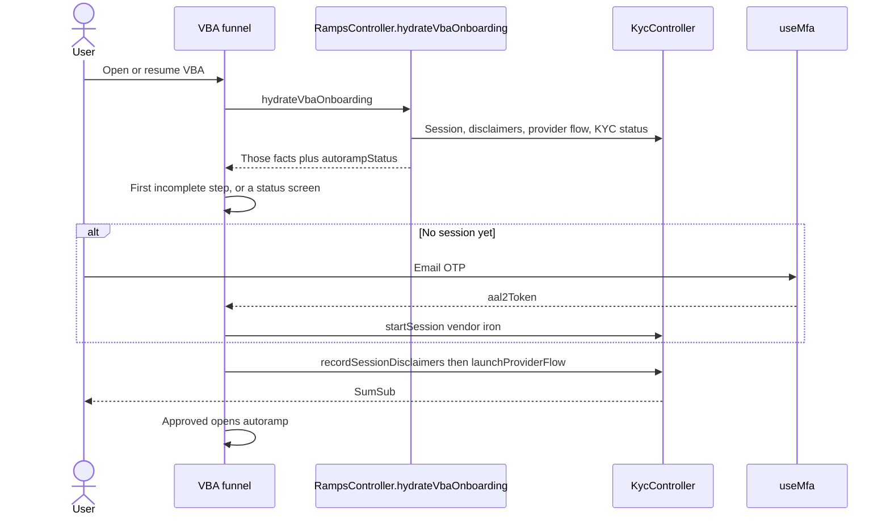
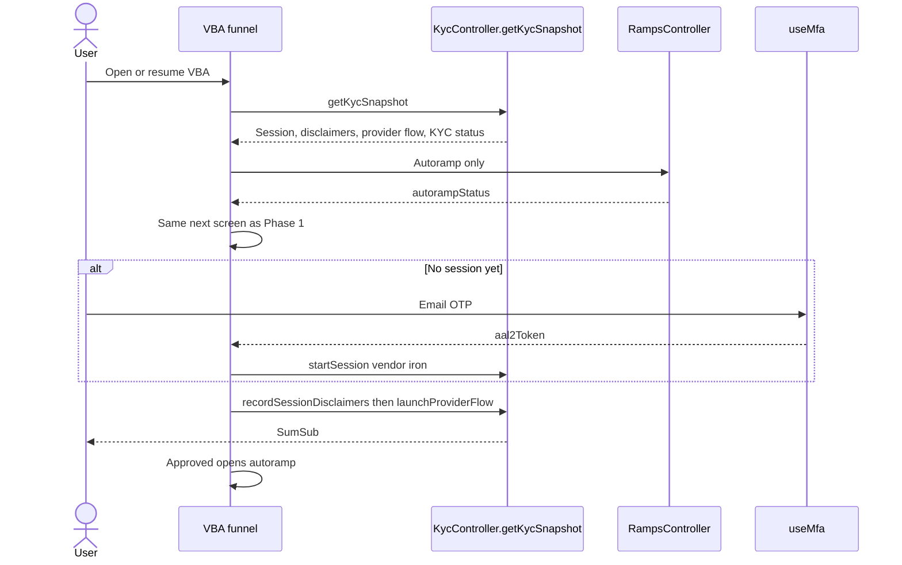
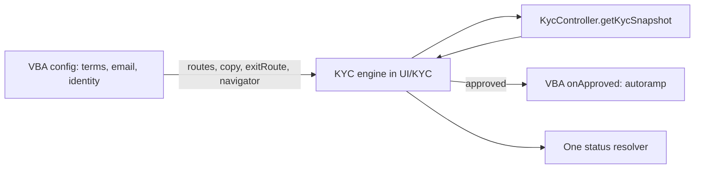
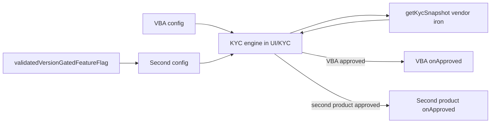

# Generalize KYC behind a per-product flow config

## Context and Problem Statement

VBA onboarding owns the identity flow. `VBA_ONBOARDING_MODULES` orders vendor terms, email OTP, then identity verification. When a screen finishes, it does not open the next one. It reloads a snapshot and `getVbaDestinationForSnapshot` picks the first incomplete step, or a status screen for rejected, retry, pending, or approved. That snapshot comes from `RampsController.hydrateVbaOnboarding`, which mixes those KYC facts with `autorampStatus`. An approved user with no autoramp therefore looks like unfinished KYC.

Screens under `UI/KYC` import Ramp routes, VBA copy, and a Money-home exit. KYC status is encoded separately in `resolveVbaKycStatus`, `getVbaDestinationForSnapshot`, `useVbaHomeCard` (`getVbaHomeCard`, `shouldRefreshKycSessionOnFocus`), `isTerminalVbaKycStatus`, and `resolveKycStatus` in `vbaTransactionAnalytics.ts`.

Another product needs the same identity checks, with its own step order, its own optional steps, and its own screen after approval. How should it run KYC without taking VBA's autoramp, routes, or a second Iron session?

## Decision Drivers

* A second product reuses an integrated vendor. Today that vendor is `iron`: one session per user and vendor, one SumSub level, and one consent catalog for that vendor's country.
* The KYC session is not the product flow. Autoramp, currency, and the account screen belong to VBA. The next product brings its own post-approval step.
* `recordSessionDisclaimers` and `launchProviderFlow` must run back to back. Split, idOS returns "Failed to get applicant".
* A new session needs an `aal2Token` from `useMfa`. That token proves the MetaMask email. A step added later, such as a partner OTP, does not produce one.
* VBA's routes, copy, and behavior stay in place while the engine is extracted.
* No UKYC API change. The status push is already `notification_type: 'kyc'`, with one set of locale keys and the tap target `https://link.metamask.io/kyc/:sessionId`.

## Considered Options

1. Per-product `KycFlowConfig` over one KYC engine in `UI/KYC`. The session stays per user and vendor. Product progress stays on the product.
2. Leave the funnel in VBA and have the next product import those Ramp modules.

## Decision Outcome

Chosen option: "1. Per-product `KycFlowConfig` over one KYC engine", because the next product can change step order and optional steps without a second Iron session or a copy of the VBA funnel.

VBA is config 1: vendor terms, then email, then identity. Approval opens autoramp through `onApproved`, which is VBA's callback, not a KYC step. Each screen still reloads the snapshot and asks the engine for the first incomplete step.

```ts
type KycFlowConfig = {
  productId: string;
  vendor: 'iron';
  steps: KycStepId[];
  mfaOperation: string;
  exitRoute: string;
  strings: KycFlowStrings;
  testIdPrefix: string;
  traceFlow: string;
  onApproved: (navigation: NavigationProp) => void;
};
```

`exitRoute` replaces the Money-home exits now hardcoded in `SumSubKyc`, `VerifyIdentity`, `KycPending`, and `IdentityVerified`. `strings`, `testIdPrefix`, and `traceFlow` replace `virtual_bank_account.*`, `vba-*` test ids, and `flow: 'vba'`.

`mfaOperation` is the `reason.operation` passed to `useMfa` when the email step asks for the `aal2Token`. VBA uses `vba.verifyEmail`. The MFA kit sends that string as a trace tag, and it uses it to tell one in-flight verification from another. It does not choose the method. The email step still asks for `email_otp`.

The engine enforces four rules while it runs a config:

* A new session takes an `aal2Token` from `useMfa`. Resume uses the stored session and skips OTP.
* `recordSessionDisclaimers` and `launchProviderFlow` run back to back.
* Every config includes the idOS and SumSub consent step. The config chooses where it sits.
* `recordVendorDisclaimers` runs after `startSession` has set `vendor` and `email`. A config that shows terms before OTP, as VBA does, saves the accepted ids locally and replays them once the session exists.

`steps` can gain a step that does not exist today. `partnerMfa` is the example: a view, supplied by the product, that collects a partner email code and an SMS code after `email`. The engine would show that view and wait. It would not call the partner, and the step would not return an `aal2Token`. Kalshi is the case that would need it. VBA does not.

`createSession` looks up the user and vendor and returns that session when it already exists, after resetting its wrapping keys. A second product on `iron` continues VBA's session, SumSub level, and approval. Iron customer, terms, and signings run only when that product's config lists a vendor-terms step. Consents already recorded for that vendor and country are reused. SumSub runs only when the session is not yet approved.

The KYC snapshot is session, disclaimers, provider-flow status, and KYC status. `KycController.getKycSnapshot` returns it. Mobile stops composing those facts from `readSessionStatus`, `hasCompletedVendorDisclaimers`, `hasCompletedSessionDisclaimers`, and `getProviderFlowStatus`. `hydrateVbaOnboarding` stops returning them. VBA reads autoramp next to the snapshot. The status reads listed above call one resolver.

### Consequences

* Good, because an approved Iron session is reused. The user does not repeat SumSub for a second product on `iron`.
* Good, because a new step, such as `partnerMfa`, can be added after `useMfa` without becoming the credential that creates the session.
* Bad, because `UI/KYC` must take routes, copy, and the exit from the config. That extraction is the large share of the work.
* Bad, because route names and `vba-*` test ids stay as aliases until dashboards and E2E read the new ids. Trace screen ids in `vbaScreenPerformance.ts` use those route names.

### Confirmation

The VBA onboarding tests pass before the move and after every later phase. A phase that fails them has changed VBA and is not done. Once VBA is config 1, its screens, copy, and back stack still match those tests. The second product cannot call `startSession` with a vendor other than `iron` under this decision.

## Migration plan

VBA's routes, copy, and behavior stay in place through the extraction. VBA becomes config 1. The second product is a second config, behind a flag. Mobile is **L**. Core is **S** for `getKycSnapshot`. The API does not change. Together that is **L**. The per-vendor session map in More Information is a later **M** and is not in this total.

During the move, keep these stable or update them in the same PR: `VbaOnboardingNavigator.test.tsx`, `VbaStatusAdapters.test.tsx`, the Money home tests that mock `vbaCufTrace`, the fixtures in `initial-background-state.json`, `default-fixture.json`, and `tests/component-view/mocks.ts`.

**Phase 1. Record what VBA does today.** Run the tests for `vbaOnboardingFunnel`, `useVbaOnboardingRouting`, and the KYC screens, and keep them as the checklist. They already say which screen comes next and where back goes. Phases 2 to 5 are accepted only when these same tests still pass.

Nothing in the running flow changes. One hydrate still returns KYC facts and `autorampStatus` together, and that mix picks the next screen.



**Phase 2. Move the KYC snapshot to `KycController`.** Add `getKycSnapshot`. It returns session, disclaimers, provider-flow status, and KYC status, and it does not return `autorampStatus`. Land that core release before Phase 3. Mobile calls `getKycSnapshot` instead of composing the same facts. `hydrateVbaOnboarding` stops returning KYC facts. VBA reads autoramp beside the snapshot.

The screens stay in the same order. Only the read splits: KYC facts come from `getKycSnapshot`, and autoramp comes from Ramps.



**Phase 3. Move the engine, with VBA as config 1.**

* Move destination resolution, the navigator, and the step screens into `UI/KYC`. The config supplies routes, copy, and `exitRoute`. The engine resets the onboarding stack it was given. It stops walking parent navigators for `VbaVendorTerms` or `RampVbaOnboarding`, which only exist on VBA's stack.
* Point the status reads at one resolver.
* Express VBA as config 1, with vendor terms before email. Keep the current route names and `vba-*` test ids behind aliases so dashboards and E2E do not move in this phase.

The user still sees the Phase 2 order. What moves is ownership: the engine in `UI/KYC` reads VBA's config, asks `getKycSnapshot` for the next step, and resets the navigator VBA passed in. Approval calls VBA's `onApproved`.



VBA-only behavior stays on that config: autoramp, Choose Currency, account-creation errors, VBA details, CUF traces, the `moneyMovementNeobank` gate, MoonPay / Iron branding, Money home entry points, and the wallet-keyed vendor-terms store.

**Phase 4. Add the second config behind `validatedVersionGatedFeatureFlag`.** That helper is how the app reads a remote flag shaped as `{ enabled, minimumVersion }`. The second product is in the build, and it stays off until the flag is enabled and the installed app is at least `minimumVersion`. An older build that does not contain this config cannot turn the product on. Turning the flag off hides the product without a new release. VBA is not behind this flag. The second config passes `vendor: 'iron'` and uses the session and consents already stored for that vendor. A step that does not exist yet, such as `partnerMfa`, is built only if that product collects a partner email code and SMS code. The KYC push and `https://link.metamask.io/kyc/:sessionId` stay as they are. The mobile handler for that link opens the KYC flow.

The engine and the Iron session stay the ones from Phase 3. The flag only adds a second config. Both products read `getKycSnapshot` for `iron`. Each approval returns to that product.



**Phase 5. Remove the aliases** once dashboards and E2E read the new ids.

## Pros and Cons of the Options

### Option 1: Per-product `KycFlowConfig` over one KYC engine

The engine reads `steps` and returns the first incomplete KYC step. `onApproved` returns control to the product.

* Good, because a step can be left out or added later, and the SumSub consent-then-launch rule stays in one place.
* Good, because the snapshot has no `autorampStatus`, so account setup cannot be reported as a KYC status.
* Neutral, because `getKycSnapshot` is a small core addition. The mobile extraction is the large share of the work.
* Neutral, because each product passes the navigator that owns its onboarding screens. The shared engine no longer walks the tree looking for `VbaVendorTerms` or `RampVbaOnboarding`. Passing the wrong navigator replaces the wrong screens.

### Option 2: Leave the funnel in VBA

The next product imports Ramp screens, `useOpenVbaOnboarding`, and VBA copy, and branches after approval.

* Good, because VBA behavior does not move.
* Bad, because the next product inherits Money-home exits, `vba-*` ids, and autoramp mixed into the KYC snapshot.
* Bad, because a third product copies the same branch again.

## More Information

* When a second vendor must stay stored while `iron` is in progress, persist one session per vendor. `startSession` writes `sessions[vendor]` and leaves the other entries in place. Each entry holds `sessionStatus` and `providerFlowStatus`, because the provider-flow flag is not on the server status and a `reset` today brings it back as `not_started`. `readSessionStatus`, `refreshSessionStatus`, `launchProviderFlow`, and the disclaimer checks take a vendor. VBA always passes `iron`. Poll the session on screen. Do not poll every stored session. Migrate the current flat slot into `sessions.iron`. Add the new vendor to `KycVendor` in that change. `KycVendor` is `moonpay` and `iron` today. This is a later core change, about **M**, plus a small mobile follow-up. It is not part of the migration above. Two products on the same vendor still share one entry.
