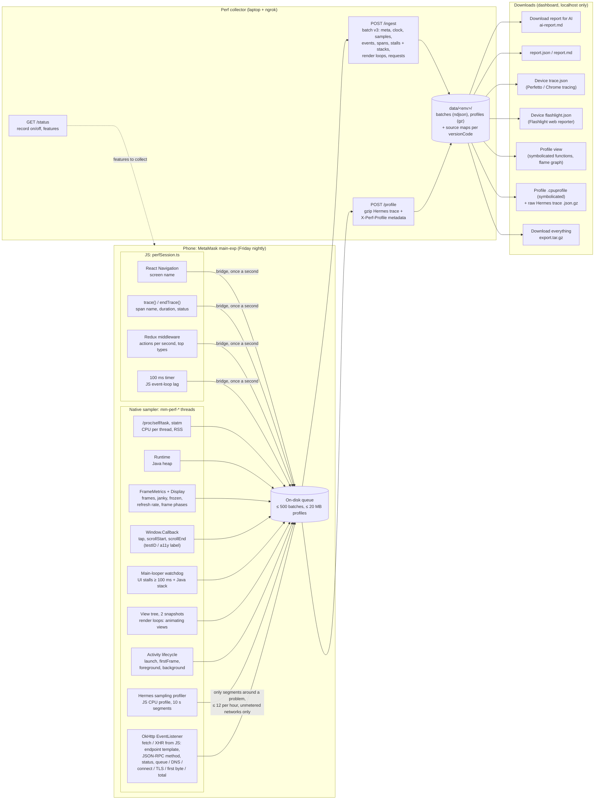

# Perf sessions

Find performance problems while people use **Friday's nightly main-exp build** normally, unplugged, with Flashlight-style metrics (CPU per thread, FPS, RAM). Testers install the build and use it; there is nothing to set up, tap or send. An in-app sampler (`PerfSession.kt`) records while the app is in the foreground and uploads over HTTPS to the perf collector, a separate project.

## Data flow

Everything the phone sends, where it comes from, and where it can be downloaded. The phone only talks to three collector endpoints. Every request carries the env name and the build's key.

| Data                                     | ai-report.md                 | report.json / .md               | trace.json              | flashlight.json | Profile view / .cpuprofile | export.tar.gz |
| ---------------------------------------- | ---------------------------- | ------------------------------- | ----------------------- | --------------- | -------------------------- | ------------- |
| CPU per thread, FPS, janky/frozen, RAM   | ±5 s around each problem     | per screen                      | ✓                       | ✓               |                            | ✓ raw         |
| Frame phases, slowest frame              | ±5 s around each problem     | per screen                      | ✓                       |                 |                            | ✓ raw         |
| Java heap                                |                              | ✓                               | ✓                       |                 |                            | ✓ raw         |
| JS lag                                   | ✓                            | ✓                               | ✓                       | ✓               |                            | ✓ raw         |
| Redux actions                            | ✓                            | ✓                               |                         |                 |                            | ✓ raw         |
| Screens, taps, scrolls, lifecycle events | 10 s before each problem     | last tap before each problem    | ✓                       |                 |                            | ✓ raw         |
| Spans                                    | overlapping each problem     | per screen                      | ✓                       |                 |                            | ✓ raw         |
| UI stalls and stacks                     | ✓                            | per screen                      | ✓                       |                 |                            | ✓ raw         |
| Render loops                             | ✓                            | per screen                      | ✓                       |                 |                            | ✓ raw         |
| Network requests                         | per endpoint, per span, ±5 s | per endpoint, per problem, span | Network track           |                 |                            | ✓ raw         |
| Hermes profiles                          | top functions, hottest path  |                                 | samples on the timeline |                 | ✓                          | ✓ both + raw  |
| Sampler overhead (selfCpu, features on)  | fixed note only              | ✓ (per feature set)             | ✓                       | ✓               |                            | ✓ raw         |

**Download everything** (`export.tar.gz`) has every record the collector holds for the env and window, unaggregated (`devices/<id>/records.json`), each device's `trace.json`, the three reports, and every profile as `.cpuprofile` (symbolicated, opens in Chrome DevTools, speedscope or VS Code), the raw upload and its metadata. Everything the sampler collects is downloadable.

## What's measured

Every second while MetaMask is in the foreground, tagged with the focused screen:

- **CPU per thread** from `/proc/self/task`, the same data Flashlight reads: JS thread (`mqt_v_js`), `UI Thread`, `RenderThread` and the busiest others. The sampler's own threads (`mm-perf-*`) and Hermes' profiler timer (`hermes-sampling*`) are left out and reported separately as `selfCpu`.
- **FPS and janky frames** from Android FrameMetrics (janky: missed its deadline; frozen: over 700 ms), against the display's **actual refresh rate in that window** (`refreshRate`; adaptive displays switch between 60 and 120 Hz). FPS is only reported while the screen is actively rendering (at least 25% of the refresh rate). Below that the window is an idle redraw: frame counts are still sent, FPS is `null`.
- **RAM** (RSS) from `/proc/self/statm` and the Java heap in use.

Batches of 10 samples (about 10 s) are written to app storage and POSTed to the collector, and flushed whenever the app goes to the background, because it may be killed there. Failed uploads stay queued (up to 500 batches) and are retried on the next flush.

Only perf data, the screen name (static route names, never route params), device model, OS version and app version are sent. Each install gets a random `deviceId`. Anything that looks like user data (`0x` + 6 or more hex digits, or 6 or more digits in a row) is dropped from every string before it leaves the device.

## Optional features

The collector switches each of these on or off per env at runtime (`features` in `GET /status`), so their overhead can be measured and anything too costly turned off without a rebuild. Each batch lists the features that were active (`features`).

| Feature        | What it adds                                                                                                                                                                   | Where                                                                               | Expected cost                                                                                                           |
| -------------- | ------------------------------------------------------------------------------------------------------------------------------------------------------------------------------ | ----------------------------------------------------------------------------------- | ----------------------------------------------------------------------------------------------------------------------- |
| `spans`        | Completed `trace()` spans (name, id, start, duration, status; never `data` or `tags`), regardless of Sentry consent                                                            | `app/util/trace.ts` → `perfSession.ts`, one bridge call per second                  | A `Date.now()` and a small object per trace                                                                             |
| `interactions` | `tap`, `scrollStart`, `scrollEnd` events named by the touched view's testID (or accessibility label)                                                                           | `PerfInteractions.kt`, a Window.Callback wrapper that never consumes events         | One hit test of the view tree per gesture, on the main thread                                                           |
| `framePhases`  | For janky frames: mean ms per frame spent in input, animation, layout, draw, sync and GPU, plus the slowest frame                                                              | `PerfSession.kt` (FrameMetrics)                                                     | A few additions per janky frame                                                                                         |
| `redux`        | Actions dispatched per second and the top 5 types (`UPDATE_BG_STATE:<Controller>` for Engine updates)                                                                          | Redux middleware in `app/store`                                                     | A map increment per action                                                                                              |
| `jsLag`        | Max JS event-loop lag per second                                                                                                                                               | 100 ms interval in `perfSession.ts`                                                 | 10 timer callbacks per second on the JS thread                                                                          |
| `uiStalls`     | Main thread blocked ≥ 100 ms: duration, screen and the most frequent stack                                                                                                     | `PerfStallWatchdog.kt` (`mm-perf-watchdog`)                                         | 10 pings per second to the main Looper; stack samples only during a stall                                               |
| `profiles`     | Hermes CPU profiles around problems                                                                                                                                            | `PerfProfiles.kt`                                                                   | Hermes sampling while on, a dump every 10 s; see below                                                                  |
| `renderLoops`  | When a screen keeps drawing with nobody touching it: the views responsible, each with a reason (`moving`, `playing`, `drawable`, `surface`) and its layer type                 | `PerfRenderLoops.kt`                                                                | Two view-tree walks on the main thread, at most once per 30 s per screen                                                |
| `network`      | Every fetch / XHR from JS: host, path template (ids, keys and addresses → `:id`, no query), JSON-RPC method, status or error, queue / DNS / connect / TLS / first byte / total | `PerfNetwork.kt`, an OkHttp EventListener on React Native's NetworkingModule client | A few timestamps per request on OkHttp's threads; the first 2 KB of small JSON bodies are copied to read the RPC method |

**Render loops.** JS profiles can't explain a screen that burns the RenderThread or GPU while JS is idle (a looping Lottie or Rive animation, a shimmer, a spinner, a video). When for 3 s in a row nobody touched the screen and it kept drawing (≥ 25% of the refresh rate) or the RenderThread stayed above 50% of a core, the sampler walks the view tree twice, 150 ms apart, and reports up to 20 views: `moving` (position, transform or alpha changed: Reanimated, native-driver Animated, shimmers), `playing` (the view says so: Lottie `isAnimating()`, Rive and video `isPlaying()`), `drawable` (a running animated image) or `surface` (a visible TextureView, SurfaceView or WebView). Each comes with its testID (or the nearest named ancestor's) and layer type; a `software` layer is re-rasterized and re-uploaded every frame, which shows up as a long FrameMetrics sync phase. `proguard-rules.pro` keeps the getters it looks up by name.

**Profiles.** While on, recording and in the foreground, the Hermes sampling profiler runs and is dumped every 10 s to an app-private segment file (dumping clears its buffer); only the last two segments are kept. A segment that saw a frozen frame, a UI stall, JS lag ≥ 250 ms, a janky burst (≥ 30% janky for 3 s) or a busy JS thread (≥ 80% for 3 s) is gzipped and uploaded to `POST /profile` together with the previous segment; the rest are deleted. At most `maxPerHour` (default 12) are captured, uploads only run on unmetered networks, and the queue is capped at 20 MB. On RN 0.86 `HermesSamplingProfiler.disable()` works, so the sampler is really stopped in the background and when the feature or the collector is off. The shake-to-profile `ProfilerManager` (exp and RC builds) uses the same global sampler: while it records, automatic profiles pause and their buffer is discarded first, so the two never steal each other's samples. Sentry's profiler also drives this sampler (it disables it and drains the buffer at the end of every transaction), so builds with the perf session set Sentry's `profilesSampleRate` to 0; Sentry tracing and errors are unchanged.

## Time and cross-referencing

Every sample, event, span, stall and profile carries two clocks:

- `t`: wall clock, Unix epoch ms.
- `mono`: monotonic µs, `System.nanoTime() / 1000` (CLOCK_MONOTONIC).

Each batch adds a `clock` pair (`t`, `mono`, `tzOffsetMin`) taken at the same instant, and `meta.processStartMono` gives the process start on the same monotonic base (converted from `Process.getStartElapsedRealtime()`, which uses CLOCK_BOOTTIME). Spans are timed in JS with epoch ms and converted to `mono` natively.

**Hermes profiles.** The sampling profiler's trace timestamps come from `std::chrono::steady_clock`, which is CLOCK_MONOTONIC on Android, serialized in µs: the same base as `mono`. Hermes ships prebuilt, so this is from the Hermes sources rather than code in this repo; each uploaded profile carries the `mono` of its segment's start and end, which lets the collector confirm the alignment (the trace's `ts` range must fall inside it). The same applies to profiles from react-native-release-profiler / `ProfilerManager`, so they can be lined up with a device's perf session through the batch `clock` pairs.

## The collector is the on/off switch

The app calls `GET /status?env=<env>` at launch, on resume and every few minutes. It only records while the collector answers `{"record": true}` for its env (`main-exp`, `main-rc`, ...). When the collector is off, unreachable or says no, nothing is sampled or queued, so turning the collector off stops every installed build within minutes.

## Which builds have it

Only the **scheduled Friday nightly Android main-exp build**, plus manual `main-exp` builds where someone checks `perf_session` to test a branch. Every other build, including other nightlies, unchecked manual builds, RC and production, compiles without it: the native module isn't registered and the JS side is a no-op.

- `.github/workflows/nightly-build.yml` runs a `perf-session-day` job: when the run was triggered by the schedule and the UTC day is Friday, it passes `perf_session: true` to the Android `main-exp` build.
- `.github/workflows/build.yml` turns that into `MM_PERF_SESSION_ENABLED=true` for the Gradle build. The same `perf_session` input (default off) is on the manual **Build** dispatch, so a branch can be tested before Friday: Actions → Build → Run workflow, `source_branch` = your branch, `build_name` = `main-exp`, platform `android`, check `perf_session`. It is ignored for any other build name.
- `android/app/build.gradle` compiles the sampler in only with `MM_PERF_SESSION_ENABLED=true`, and fails the build if the flag is set on anything other than a `main-exp` build. With the flag, the URL must be an `https://` origin and the key 24–128 characters of `[A-Za-z0-9_-]`.
- `MM_PERF_SESSION_URL` and `MM_PERF_SESSION_KEY` come from the `*perf_session` anchor in `builds.yml` (merged into `main-exp`). On their own they do nothing.

So the collector only needs to run while testers use a Friday nightly build. Builds from previous Fridays keep recording whenever the collector is on, because the collector is still the on/off switch.

**The URL and key are public by design.** They are committed here and ship inside the APK. Security comes from the collector: it validates every batch strictly, rate-limits, caps storage, and only exposes the upload and status endpoints. Dashboards stay on localhost.

## The collector

The collector is a separate project, not part of this repo. It receives batches, serves the live dashboard and reports, and exports devices in Flashlight's result format (`npx @perf-profiler/web-reporter report <file>`).

Code: `android/app/src/main/java/io/metamask/nativeModules/PerfSession/`, `app/core/Performance/perfSession.ts` (wired in `NavigationProvider.tsx`, the Redux store and `app/util/trace.ts`). Android only for now.

## Known limits

- The collector URL is baked in at build time. Use a hostname you control so the collector can move (laptop, then a cloud host) without rebuilding.
- Anyone with the APK can send fake perf data. The collector can limit and flag it, not prevent it.
- iOS isn't covered (FrameMetrics and `/proc` are Android-specific).
