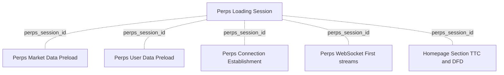

# Perps performance Sentry contract

How Mobile Perps measurements map to Sentry. It holds no performance values. Core-owned trace and measurement names are in the [Core traces contract](https://github.com/MetaMask/core/blob/main/packages/perps-controller/docs/contracts/traces.md).

## Rule

Reuse the existing startup, preload, connection, first-data, Homepage-section and critical-user-flow traces. Add only emitted attributes and one slim loading session. No boundary has two producers.

## Trace topology

- These are independent root transactions. The session is not a parent and copies none of their durations.
- `Perps Market Detail Session` is also an independent root. It shares bounded lifecycle, provider, network and mode attributes with the reused traces but does not join or copy them.
- `Perps Connection Establishment` belongs to the singleton connection manager, not to the visible screen. The wallet-root lifecycle owner and guarded screen recovery use the same manager, so one attempt can serve several screens. Do not add a screen attribute to it. Each screen keeps the trace whose start and end it owns.

Code: `app/components/UI/Perps/utils/perpsLoadingSession.ts` `startPerpsLoadingSession`; `app/components/UI/Perps/hooks/usePerpsMarketDetailSession.ts`; `app/components/UI/Perps/services/PerpsConnectionManager.ts`; `app/components/UI/Perps/providers/PerpsAlwaysOnProvider.tsx` `PerpsAlwaysOnProvider`

## Existing traces

| Stage                      | Trace                                                                         | Mobile additions                                                                                           |
| -------------------------- | ----------------------------------------------------------------------------- | ---------------------------------------------------------------------------------------------------------- |
| Script load                | `Load Scripts`                                                                | None                                                                                                       |
| UI mount                   | `UI Startup`                                                                  | None                                                                                                       |
| Authentication             | `Authenticate User`                                                           | None                                                                                                       |
| Homepage readiness         | `Homepage Ready`                                                              | None; carries `start_source`, `app_start_type`                                                             |
| Global market preload      | `Perps Market Data Preload`                                                   | Loading-session trace data                                                                                 |
| User preload               | `Perps User Data Preload`                                                     | Loading-session trace data                                                                                 |
| Connection                 | `Perps Connection Establishment`                                              | Loading-session trace data; provider-init, health, socket and subscription measurements                    |
| First live streams         | `Perps WebSocket First Price`, `Positions`, `Orders`, `Account`, `Order Book` | `perps_session_id`, account, context and connection generations                                            |
| Homepage Perps TTC and DFD | `Homepage Section Time To Content`, `Homepage Section Data Fetch`             | Tags `content_variant`, `lifecycle`, `surface`, `market_source`, `account_source`; data `perps_session_id` |
| Critical flows             | Perps CUF traces                                                              | `lifecycle_context` start tag                                                                              |

Code: `app/util/trace.ts` `TraceName`; `app/core/Performance/HomepageReady.ts`; `app/components/UI/Perps/adapters/mobileInfrastructure.ts` `getPreloadTraceData`; `app/components/UI/Perps/providers/PerpsStreamManager.tsx` `captureLoadingSessionTraceData`; `app/components/Views/Homepage/Sections/Perpetuals/PerpsSectionMain.tsx`; `app/components/UI/Perps/utils/perpsCufTrace.ts` `buildPerpsCufStartTags`

## Measurements by trace

### `Perps Market Data Preload` and `Perps User Data Preload`

- Core emits one overall duration each, `perps.operation.market_data_preload` and `perps.operation.user_data_preload`, with an explicit trace id. The Mobile adapter writes it to that span.
- The spans record success plus market count, or position and order counts.
- No Terminal request, parse, validation or adoption split exists. Do not query one.
- Neither preload measurement appears on the loading session.

Code: `app/components/UI/Perps/adapters/mobileInfrastructure.ts` `tracer.setMeasurement`

### `Perps Connection Establishment`

`PerpsProviderInit`, `PerpsConnectionHealthCheck`, `PerpsWebsocketConnectionEstablishment`, `PerpsSubscriptionsPreload` and `PerpsWebsocketConnectionWithPreload`, each written to the trace span.

Code: `app/components/UI/Perps/services/PerpsConnectionManager.ts`

### `Perps Loading Session`

| Measurement                                                                                                              | Clock              |
| ------------------------------------------------------------------------------------------------------------------------ | ------------------ |
| `process_to_perps_bootstrap_start_ms`, `process_to_perps_controller_constructed_ms`                                      | Process-relative   |
| `markets_ready_ms`, `account_cache_ready_ms`, `account_live_ms`, `positions_live_ms`, `orders_live_ms`, `prices_live_ms` | Bootstrap-relative |

The Homepage Perps surface starts the session at `perps_bootstrap_start`. It ends when the variant's resolved and live requirements are met ([architecture.md](./architecture.md#homepage-surface-readiness)), or at error or the 90 s timeout. Context change, backgrounding, focus loss and unmount cancel it without a success or content outcome. `prices_live` is never required.

Code: `app/components/UI/Perps/utils/perpsLoadingSession.ts` `MILESTONE_MEASUREMENTS`, `hasRequiredLiveStreams`, `cancelPerpsLoadingSession`

### Homepage section traces

Do not add another Homepage TTC or DFD transaction.

- TTC stays the resolved-content duration; DFD stays the loading duration.
- Homepage surface stages, `socket_to_visible_ms` and socket to frame splits stay recipe-only.
- Visible errors keep the existing event shape. Latency widgets filter `content_state != error`; error-rate widgets use `content_state = error`.
- The section hook writes cohort tags as start attributes and refreshes them on the same span before completion. Dashboards query span attributes; event tags are compatibility metadata.

Code: `app/components/Views/Homepage/hooks/useSectionPerformance.ts` `annotateLatestTags`; `app/components/Views/Homepage/Sections/Perpetuals/hooks/useHomepagePerpsSurfaceMetrics.ts`

## Attributes

### Bounded cohort attributes

- `release`, `environment`, `platform`
- `app_start_type` (on `Homepage Ready`, `Authenticate User` and `Login User Interaction`)
- `surface`, `content_variant`, `lifecycle`, `provider`, `network`
- `market_source` (`terminal_v2`, `provider`, `memory_cache`, `unknown`)
- `account_source` (`provider_snapshot`, `memory_cache`, `fresh_socket`, `unknown`)
- `required_live_streams_complete`, `content_state`, `success`, `failure_stage`

`hip3_config_version` (market-detail session data) may be indexed only if its production value space is shown to be bounded.

### Trace data, never group-by tags

- `perps_session_id`, `account_generation`, `context_generation`
- `connection_generation` on the loading session, first-live traces and proof records
- `marketCount`, `positionCount` and `orderCount` on the preload traces

`data_ready_at_demand` and the surface-stage fields are recipe log data. `terminal_snapshot_status`, `cache_identity_valid`, `cache_age_bucket` and `enabled_dex_fingerprint` are not emitted. Do not query them.

Never attach wallet addresses, account names, order IDs, position IDs, balances or raw upstream error bodies. The Core user-preload trace has no wallet address. Core preload catch blocks put the error message in trace data.

Code: `app/components/UI/Perps/utils/perpsLoadingSessionModel.ts` `PerpsSessionMarketSource`, `PerpsSessionAccountSource`; `app/components/UI/Perps/utils/perpsLoadingSession.ts` `startPerpsLoadingSession`, `endActiveLoadingSession`; `app/components/UI/Perps/hooks/usePerpsMarketDetailSession.ts`; `app/components/Views/Login/loginPerformanceTags.ts` `getLoginPerformanceTags`

## Generations

- A Homepage session assigns `account_generation` and `context_generation` at bootstrap.
- The first accepted positions, orders or account milestone captures the connection manager's `connection_generation`. Later fresh milestones in that session must match or be newer.
- A global price tick cannot select the generation before account data arrives.
- Cached and Terminal-only surface stages claim no socket generation.

Code: `app/components/UI/Perps/utils/perpsLoadingSession.ts` `prepareFreshSocketGeneration`, `recordValuesReady`

## Correlation

- Mobile creates one random `perps_session_id` per lifecycle or context generation at `perps_bootstrap_start`.
- Core never receives it. The Mobile tracer adapter merges it into the Core preload traces, and Mobile code adds it to the Homepage section, connection and first-live traces. It is for drill-down, not aggregation.
- Core supplies the post-hydration controller-construction timestamp through `onControllerConstructed`, and routes preload measurements to explicit trace ids. The adapter falls back to an ambient `setMeasurement` only when Core passes no id.
- No durable-cache provenance is emitted. Widgets must not label memory-hydrated rows as disk cache.
- Dashboards aggregate each transaction on its own, with the same bounded release, platform, lifecycle and source attributes. A screen can be fast because it reuses a ready connection, and a connection can complete with no Perps screen visible.

Code: `app/components/UI/Perps/adapters/mobileInfrastructure.ts` `getPreloadTraceData`, `onControllerConstructed`, `tracer.setMeasurement`; `app/components/UI/Perps/utils/perpsLoadingSession.ts` `recordPerpsControllerConstructedAt`

## Market detail

| Item                                          | Values                                                                                                   |
| --------------------------------------------- | -------------------------------------------------------------------------------------------------------- |
| Trace tags                                    | `detail_mode`, `provider`, `network`, `chart_strategy`, `generation_trigger`, `lifecycle_context`        |
| Trace data                                    | `symbol`, `chart_library`, `market_source`, `hip3_config_version`, `entry_source`, `<section>_state`     |
| `Perps Market Detail Live` failure reasons    | `generation_changed`, `stats_error`, `app_backgrounded`, `owner_cancelled`, `unmounted`                  |
| `Perps Market Detail Session` failure reasons | `section_error`, `generation_changed`, `app_backgrounded`, `surface_unmounted`, `detail_session_timeout` |

Dashboard rules that follow from these fields:

- Split detail durations by `detail_mode` and by platform and release. Never pool Android and iOS.
- Split market metadata by `market_source` and every waterfall by `lifecycle_context`.
- Navigation waterfalls filter `generation_trigger=initial`.
- Split chart rows by `chart_strategy` and `chart_library`.
- Count section errors and timeouts in reliability widgets, not latency widgets.
- Never group by market symbol or session id.

Code: `app/components/UI/Perps/hooks/usePerpsMarketDetailSession.ts` `usePerpsMarketDetailSession`; `app/components/UI/Perps/hooks/usePerpsMeasurement.ts`; `app/components/UI/Perps/hooks/usePerpsMarketDetailLiveMeasurement.ts`
