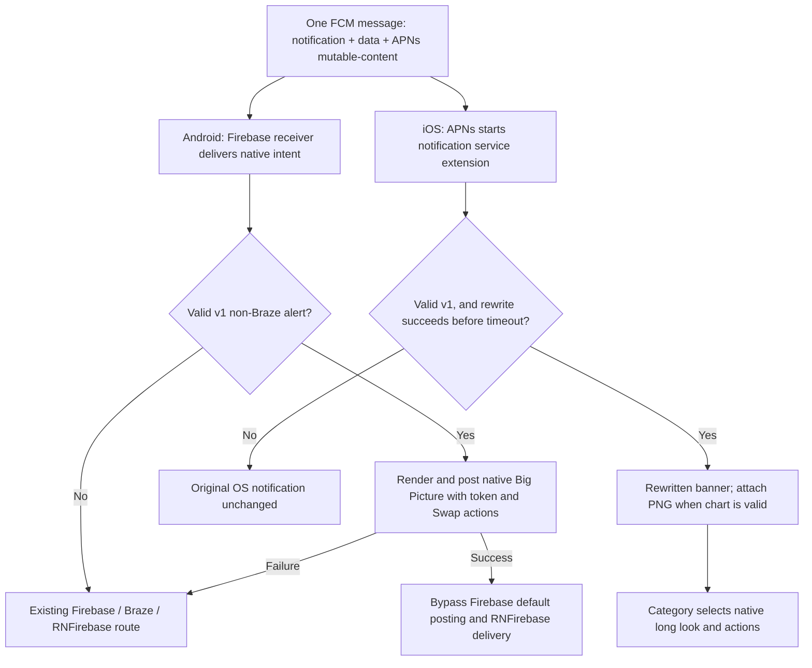

# Rich price-alert pushes (non-mergeable POC)

The server describes a threshold crossing or price movement; each client owns presentation and routing. This branch does not change the backend, alert rules, or swap execution. The rich actions open token details or prefill Swap; neither submits a transaction. There is no snooze/dismiss-alert action in this POC.

## Wire schema: `price_alert@1`

All custom fields are strings, either under FCM `message.data` or at the top level next to APNs `aps`. Keep ordinary localized alert copy and the existing token deeplink; they are not generated from the rich fields on failure.

| Field                             | Contract                                                                                           |
| --------------------------------- | -------------------------------------------------------------------------------------------------- |
| `mm_delivery`                     | `price_alert`; stable marker for routing even when the rich version is unknown                     |
| `mm_ui`                           | `price_alert@1`; unknown versions never render rich                                                |
| `kind`                            | `threshold` or `movement`                                                                          |
| `symbol`                          | 1–12 uppercase ASCII letters or digits                                                             |
| `asset_id`                        | CAIP-19 asset type, e.g. `eip155:1/slip44:60`                                                      |
| `price`                           | USD current price, positive and at most `1e12`                                                     |
| `change_pct`                      | Signed percent, absolute value at most `1e6`; zero uses the positive color                         |
| `chart`                           | Optional compact JSON string; see below.                                                           |
| `target`, `direction`             | Threshold only: positive USD target with the same bounds as `price`; `above` or `below`            |
| `period`                          | Movement only: `5m`, `1h`, or `24h`                                                                |
| `fallback_title`, `fallback_body` | Optional legacy fixture fields; native delivery uses `notification` / `aps.alert` for fallback     |
| `deeplink`                        | Existing fallback token deeplink; rich actions instead derive fixed MetaMask links from `asset_id` |

Use plain decimal strings (no exponents, spaces or grouping). Keep the complete provider payload within its size limit. Do not send `mm_local`; it is a client marker. Rich labels are English-only for this POC.

## Chart blob v1

`chart` is a compact JSON **string** on both FCM and APNs, not a nested object. Its decoded shape is `{v: 1, currency: "usd", start: <Unix seconds UTC>, interval: <seconds>, prices: [<USD number>, ...]}`. Samples are oldest first on a regular grid, with both endpoints included. Use 49 prices at 30-minute spacing or 97 at 15-minute spacing so `(prices.length - 1) * interval` is exactly 86,400 seconds. The renderer pins the final sample to the alert's top-level `price` and calculates 24h high/low from the displayed samples, not from intrabar highs/lows or the threshold. The threshold line shares the same USD scale, with the plotted domain extended to include it if needed. Movement `period` describes the trigger, not the chart window.

At send time, fetch or reuse cached USD history for `asset_id`, resample onto a grid ending at the trigger time, and set the last value to the trigger quote. Send only finite positive prices up to `1e12`; omit `chart` if there isn't enough history or it won't fit. Cap the blob at 2,048 bytes and measure the full serialized provider payload (including fallback copy and JSON escaping) against the 4 KB limit. Missing, malformed, or unsupported chart blobs leave the rich price card and its actions intact, without a chart. Invalid alert metadata still uses the ordinary fallback.

Fixtures use actual [Coinbase Exchange ETH-USD candle closes](https://docs.cdp.coinbase.com/exchange/reference/exchangerestapi_getproductcandles), sampled every 30 minutes from the 15-minute candles starting July 23–25, 2026 UTC, timestamped at candle close; the sample trigger prices are the final closes, not live quotes.

## Delivery and fallback

Send the same mixed FCM message to every install: `message.notification` contains the original title and body, `message.data` contains the price alert fields, and `message.apns.payload.aps` includes `mutable-content: 1`. The sender does not set a rich category or gate by client version. For direct APNs, use `aps.alert` for the original copy and put the custom fields alongside `aps`.



On Android, the native service intercepts before Firebase’s background display, and the RNFirebase receiver bypasses candidates that the native service handles. Unknown versions, invalid alerts, and Braze pushes continue through the existing Firebase → Braze → RNFirebase path. A rich-post failure returns to Firebase's original notification path. Force stop is an OS limit: neither the rich nor default FCM path is expected to run until the app is reopened. Ordinary process death is not Force stop.

On iOS, the service extension rewrites text, sets the category, and attaches a local PNG when the chart validates. Invalid alert metadata, an attachment failure, or expiration returns the original content unchanged. A missing or invalid optional chart still permits rich copy and long look; the spinner-free content extension renders from userInfo, not the attachment. Physical iOS builds need signing/provisioning for both `io.metamask.MetaMask.PriceAlertContent` and `io.metamask.MetaMask.PriceAlertService`; the app must be opened once to grant permission and register actions.

**Risks:** Android relies on the Firebase Messaging `handleIntent` order and the RNFirebase receiver contract; regressions in service resolution, SDK notification delegation, duplicate delivery, and Braze forwarding need real transport QA. The iOS service extension has OS-enforced time and memory limits; it uses a bounded 600 × 300 local PNG, performs no network requests, and submits the original content on timeout or handled errors.

## QA handoff

Use a main debug app with an unlocked Ethereum Mainnet test wallet and notifications enabled. On Android the Play emulator blocks `adb root`, and the shell is not allowed to send Google’s protected FCM broadcast. The debug-only ADB receiver constructs the same mixed Firebase intent, then calls the native interceptor. This tests the interceptor and default display, not Play Services routing or FCM transport. Test foreground, press Home for background, then repeat after killing the app process without setting the stopped flag:

```sh
samples=app/util/notifications/priceAlerts/samples
adb shell input keyevent KEYCODE_HOME
pid=$(adb shell pidof io.metamask | tr -d '\r')
[ -z "$pid" ] || adb shell run-as io.metamask kill -9 "$pid"
adb shell pidof io.metamask # expect no PID immediately before the send
adb shell dumpsys package io.metamask | grep -m1 stopped= # expect stopped=false

# Run from the repo root; substitute malformed.fcm.json for fallback.
python3 - "$samples/threshold.fcm.json" <<'PYTHON'
import json, shlex, subprocess, sys
payload = json.load(open(sys.argv[1]))["message"]
message = json.dumps({k: payload[k] for k in ("notification", "data")}, separators=(",", ":"))
subprocess.run(["adb", "shell", "am broadcast -n io.metamask/io.metamask.pricealerts.PriceAlertSimulationReceiver --es message " + shlex.quote(message)], check=True)
PYTHON
adb shell cmd statusbar expand-notifications
```

Real FCM after ordinary process death remains unverified. For iOS, use the extension-capable main simulator build; grant permission first (the `showPriceAlertSample('threshold')` DevTools call can prompt), then background the app. Run from the repository root, one case at a time:

```sh
samples=app/util/notifications/priceAlerts/samples
xcrun simctl push booted io.metamask.MetaMask "$samples/threshold.apns"
xcrun simctl push booted io.metamask.MetaMask "$samples/threshold-below.apns"
xcrun simctl push booted io.metamask.MetaMask "$samples/movement.apns"
xcrun simctl push booted io.metamask.MetaMask "$samples/movement-up.apns"
xcrun simctl push booted io.metamask.MetaMask "$samples/fallback.apns"
xcrun simctl push booted io.metamask.MetaMask "$samples/malformed.apns"
xcrun simctl push booted io.metamask.MetaMask "$samples/no-chart.apns"
xcrun simctl push booted io.metamask.MetaMask "$samples/invalid-chart.apns"
```

Repeat with the app foregrounded (one notification, not two), and test tapping from a cold start. `simctl push` injects directly into the OS and does not validate FCM transport or legacy tap attribution. Capture collapsed and expanded states and button destinations on each platform:

- **Threshold above:** ETH, `$1,875.82`, green `+0.79%`, and a dashed orange `$1,875` line when expanded. Below uses `$1,872.96`, red `−3.17%`, and the same target line. Both show a 24h history, high/low markers, and the trigger quote at the endpoint.
- **Movement down:** ETH, `$1,872.96`, red `−3.17%`, `24h` chart, no target. Up uses `$1,875.82` and green `+0.79%`. iOS should show rewritten copy and an attachment when the OS invokes the service extension.
- **Body tap / View token:** opens Ethereum token details (`token-asset-overview`; `token-price` when loaded). For the above sample the target link is `https://link.metamask.io/asset?assetId=eip155%3A1%2Fslip44%3A60&source=price_alert_notification&alert_type=threshold&price_at_trigger=1875.82`.
- **Swap:** opens the swap/bridge screen (`bridge-view-scroll`, `source-token-area`) with ETH selected as the source (`https://link.metamask.io/swap?from=eip155%3A1%2Fslip44%3A60`). Verify it doesn't start a transaction. Use a fresh alert for each tap.
- **Missing chart / invalid chart:** rich price, change and actions, but no history, high/low, or target marker.
- **Unknown version / malformed:** only `ETH crossed above $1,875` / `ETH is now $1,875.82.`; no chart, chip or rich buttons in the opened notification. On iOS, malformed and unknown alerts keep their original copy and no category, so the system owns expansion. For Android, tapping fallback uses its original `deeplink`. For iOS, the sample omits Firebase transport metadata; use a real legacy FCM/APNs send to verify the pre-existing fallback tap route. OS notification views have no in-app test IDs.

## Test layer placement

Unit tests in `app/util/notifications/priceAlerts/` cover parsing, link construction, render fallback, and the older local development preview. There are no changes to existing screen test IDs. System templates, delivery, and tap routing need native QA because Jest cannot exercise the notification shade, APNs extension, or Android headless start.
